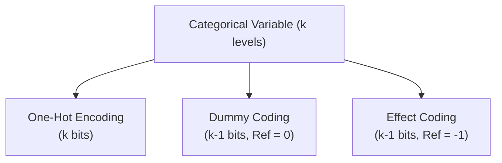

# ML4N — Part 3: Data Preprocessing
**Course:** Machine Learning for Networking (ML4N)  
**Instructor:** Prof. Luca Vassio (Politecnico di Torino)  
**Source Slides:** `3_ML4N_DataPreProcessing.pdf` (84 slides)  
**Purpose:** Optimized knowledge context for Claude / LLMs (noise-free, complete LaTeX formulas, consolidated slide animations, visual diagram descriptions, and worked quiz solutions).

---

## Table of Contents
1. [Introduction & Motivation](#1-introduction--motivation)
2. [Data Types & Attribute Properties](#2-data-types--attribute-properties)
3. [Dataset Formats & Structures](#3-dataset-formats--structures)
4. [Data Quality Issues & Remedies](#4-data-quality-issues--remedies)
5. [Similarity & Dissimilarity Metrics](#5-similarity--dissimilarity-metrics)
6. [Data Preprocessing Pipeline](#6-data-preprocessing-pipeline)
7. [Feature Transformation & Normalization](#7-feature-transformation--normalization)
8. [Discretization & Categorical Encoding](#8-discretization--categorical-encoding)
9. [Text Data Preprocessing & Representation](#9-text-data-preprocessing--representation)
10. [Self-Assessment Quiz (With Full Solutions)](#10-self-assessment-quiz-with-full-solutions)
11. [Readings & Acknowledgments](#11-readings--acknowledgments)

---

## 1. Introduction & Motivation
> 📍 *Reference: Slides 2–5*

Real-world datasets (especially network telemetry, packet captures, and server logs) are inherently imperfect:
- **Garbage In, Garbage Out:** High-performance machine learning models cannot compensate for noisy, biased, or poorly scaled training data.
- **Data Preprocessing** encompasses the full spectrum of operations that clean, transform, scale, select, and encode raw heterogeneous inputs into standardized numeric feature representations suitable for machine learning algorithms.

---

## 2. Data Types & Attribute Properties
> 📍 *Reference: Slides 6–10*

### Object and Attribute Duality
A dataset $\mathbf{X}$ is a collection of $m$ objects (rows) and $n$ attributes (columns).
- **Objects:** Also termed records, points, samples, cases, entities, or instances.
- **Attributes:** Also termed features, variables, dimensions, or fields.

### Hierarchy of Attribute Types
Attributes are categorized by the mathematical operations permissible on their values:

| Category | Attribute Type | Distinctness ($=, \neq$) | Order ($<, >$) | Addition ($+, -$) | Multiplication ($\times, /$) | Practical Examples |
| :--- | :--- | :---: | :---: | :---: | :---: | :--- |
| **Qualitative** (Categorical) | **Nominal** | Yes | No | No | No | IP protocol `{TCP, UDP, ICMP}`, eye color, postal zip code, hash values |
| **Qualitative** (Categorical) | **Ordinal** | Yes | Yes | No | No | QoS class `{Bronze, Silver, Gold}`, customer satisfaction `{1..5}`, rankings |
| **Quantitative** (Numeric) | **Interval** | Yes | Yes | Yes | No | Calendar dates, temperature in Celsius ($^\circ\text{C}$) or Fahrenheit ($^\circ\text{F}$) |
| **Quantitative** (Numeric) | **Ratio** | Yes | Yes | Yes | Yes | Absolute temperature (Kelvin), packet count, flow duration, byte throughput, delay |

> [!NOTE]
> **Interval vs. Ratio distinction:** Interval data lacks an absolute, non-arbitrary zero point (e.g., $0^\circ\text{C}$ does not mean absence of thermal energy; $20^\circ\text{C}$ is not "twice as hot" as $10^\circ\text{C}$). Ratio data possesses a true physical zero (0 bytes means no data transmitted; 200 packets is strictly twice 100 packets).

### Discrete vs. Continuous Attributes
- **Discrete:** Finite or countably infinite domain (e.g., integers, counts, binary flags, categorical labels). Often stored as integers or strings.
- **Continuous:** Uncountably infinite domain over real numbers $\mathbb{R}$ (e.g., signal-to-noise ratio, RTT, latency). Typically stored as floating-point numbers.

---

## 3. Dataset Formats & Structures
> 📍 *Reference: Slides 11–16*

1. **Tabular / Record Data:** Standard $m \times n$ matrix where each row is an independent instance with fixed feature columns.
2. **Document Data:** Unstructured text transformed into term vectors via bag-of-words or TF-IDF.
3. **Graph / Network Data:** Objects represented as nodes and pairwise relationships as edges (e.g., Internet topology, router graphs, social networks, adjacency matrices).
4. **Ordered Data:**
   - **Sequential Data:** Sequences of tokens or events where relative order matters (e.g., DNS query sequence).
   - **Time Series Data:** Continuous temporal measurements with explicit timestamps (e.g., bandwidth utilization per millisecond).
   - **Spatial Data:** Observations mapped to geographical or physical space (e.g., cell tower coordinates).

---

## 4. Data Quality Issues & Remedies
> 📍 *Reference: Slides 17–21*

### Common Quality Defects
1. **Noise:** Random distortion, variance, or background interference superimposed on legitimate measurements.
2. **Outliers:** Data objects possessing values drastically divergent from the remaining sample population.
3. **Missing Values:** Caused by sensor malfunction, dropped packets, non-mandatory input fields, or system timeouts.
4. **Duplicate Data:** Identical records or records with identical primary keys but contradictory feature values.

### Missing Data Handling Strategies
- **Record Elimination:** Drop instances with missing fields (feasible if $m$ is large and missingness is completely at random).
- **Attribute Elimination:** Drop columns if the fraction of missing values exceeds a threshold (e.g., $>50\%$).
- **Imputation:**
  - *Summary Statistics:* Replace missing entries with the feature's mean (for normal data), median (for skewed data), or mode (for categorical data).
  - *Model-Based Imputation:* Predict missing entries using $k$-NN, linear regression, or iterative decision tree models.
- **Ignore / Native Handling:** Algorithms like XGBoost or LightGBM natively route missing values along dedicated split paths.

---

## 5. Similarity & Dissimilarity Metrics
> 📍 *Reference: Slides 22–36*

### Definitions & Distance Metric Axioms
- **Similarity ($s$):** Numerical degree of resemblance between objects; higher when objects are closer, often normalized to $s \in [0, 1]$.
- **Dissimilarity / Distance ($d$):** Numerical degree of divergence; lower when objects are closer, with $d \ge 0$.

A dissimilarity measure $d(\mathbf{x}, \mathbf{y})$ on a metric space is a **Distance Metric** if and only if it satisfies four fundamental axioms for all $\mathbf{x}, \mathbf{y}, \mathbf{z}$:
1. **Non-negativity:** $d(\mathbf{x}, \mathbf{y}) \ge 0$
2. **Identity of Indiscernibles:** $d(\mathbf{x}, \mathbf{y}) = 0 \iff \mathbf{x} = \mathbf{y}$
3. **Symmetry:** $d(\mathbf{x}, \mathbf{y}) = d(\mathbf{y}, \mathbf{x})$
4. **Triangle Inequality:** $d(\mathbf{x}, \mathbf{z}) \le d(\mathbf{x}, \mathbf{y}) + d(\mathbf{y}, \mathbf{z})$

---

### Similarity / Dissimilarity for Single Attributes
| Attribute Type | Dissimilarity $d(x, y)$ | Similarity $s(x, y)$ |
| :--- | :--- | :--- |
| **Nominal** | $d = \begin{cases} 0 & \text{if } x = y \\ 1 & \text{if } x \neq y \end{cases}$ | $s = \begin{cases} 1 & \text{if } x = y \\ 0 & \text{if } x \neq y \end{cases}$ |
| **Ordinal** | $d = \frac{\|x - y\|}{n - 1}$ (where values are mapped to integer ranks $0, \dots, n-1$) | $s = 1 - d$ |
| **Interval / Ratio** | $d = \|x - y\|$ | $s = -d$, or $s = \frac{1}{1 + d}$, or $s = e^{-d}$, or $s = 1 - \frac{d - \min(d)}{\max(d) - \min(d)}$ |

---

### Minkowski Distance ($L_p$ Norm)
Given two multidimensional vectors $\mathbf{x}, \mathbf{y} \in \mathbb{R}^n$:

$$d(\mathbf{x}, \mathbf{y}) = \|\mathbf{x} - \mathbf{y}\|_r = \left( \sum_{k=1}^n |x_k - y_k|^r \right)^{\frac{1}{r}}$$

Where $r \ge 1$ is the norm parameter.

#### Special Cases
1. **Manhattan Distance ($r = 1$, City Block, $L_1$ Norm):**
   $$d_{L_1}(\mathbf{x}, \mathbf{y}) = \sum_{k=1}^n |x_k - y_k|$$
2. **Euclidean Distance ($r = 2$, $L_2$ Norm):**
   $$d_{L_2}(\mathbf{x}, \mathbf{y}) = \sqrt{\sum_{k=1}^n (x_k - y_k)^2}$$
3. **Chebyshev Distance ($r \to \infty$, Supremum, $L_\infty$ Norm):**
   $$d_{L_\infty}(\mathbf{x}, \mathbf{y}) = \max_{k \in \{1, \dots, n\}} |x_k - y_k|$$

#### Comparative 4-Point Benchmark
Consider points $p_1(0, 2), p_2(2, 0), p_3(3, 1), p_4(5, 1)$ in $\mathbb{R}^2$:

**Distance Matrices:**
- **$L_1$ Matrix (Manhattan):**
  $$\begin{bmatrix} & p_1 & p_2 & p_3 & p_4 \\ p_1 & 0 & 4 & 4 & 6 \\ p_2 & 4 & 0 & 2 & 4 \\ p_3 & 4 & 2 & 0 & 2 \\ p_4 & 6 & 4 & 2 & 0 \end{bmatrix}$$

- **$L_2$ Matrix (Euclidean):**
  $$\begin{bmatrix} & p_1 & p_2 & p_3 & p_4 \\ p_1 & 0 & 2.828 & 3.162 & 5.099 \\ p_2 & 2.828 & 0 & 1.414 & 3.162 \\ p_3 & 3.162 & 1.414 & 0 & 2.000 \\ p_4 & 5.099 & 3.162 & 2.000 & 0 \end{bmatrix}$$

- **$L_\infty$ Matrix (Chebyshev):**
  $$\begin{bmatrix} & p_1 & p_2 & p_3 & p_4 \\ p_1 & 0 & 2 & 3 & 5 \\ p_2 & 2 & 0 & 1 & 3 \\ p_3 & 3 & 1 & 0 & 2 \\ p_4 & 5 & 3 & 2 & 0 \end{bmatrix}$$

---

### Mahalanobis Distance
Standard Euclidean distance treats all dimensions independently and with equal variance. When features have different variances and inter-feature correlations, Euclidean distance creates distorted spherical contours.

The **Mahalanobis Distance** measures distance with respect to the distribution's covariance matrix $\mathbf{\Sigma}$:

$$d_{\text{Mahal}}(\mathbf{x}, \mathbf{y}; \mathbf{\Sigma}) = \sqrt{(\mathbf{x} - \mathbf{y})^T \mathbf{\Sigma}^{-1} (\mathbf{x} - \mathbf{y})}$$

**Properties:**
- **Scale-Invariant & Unitless:** Dividing any feature by a constant does not alter the Mahalanobis distance.
- **Accounts for Correlation:** Aligns the distance metric along the principal axes of covariance.
- If features are uncorrelated with unit variance ($\mathbf{\Sigma} = \mathbf{I}$), Mahalanobis distance simplifies to standard Euclidean distance.

---

### Binary Similarity & Dissimilarity
For binary vectors $\mathbf{x}, \mathbf{y} \in \{0, 1\}^n$, build the $2 \times 2$ contingency table:
- $f_{11}$: Number of attributes where both $\mathbf{x}$ and $\mathbf{y}$ are 1.
- $f_{10}$: Attributes where $\mathbf{x}=1$ and $\mathbf{y}=0$.
- $f_{01}$: Attributes where $\mathbf{x}=0$ and $\mathbf{y}=1$.
- $f_{00}$: Attributes where both $\mathbf{x}$ and $\mathbf{y}$ are 0.

1. **Simple Matching Coefficient (SMC):** Appropriate for symmetric binary attributes (presence and absence carry equal significance):
   $$\text{SMC} = \frac{f_{11} + f_{00}}{f_{11} + f_{10} + f_{01} + f_{00}}$$
2. **Jaccard Similarity ($J$):** Appropriate for asymmetric binary attributes (presence is informative, joint absence is uninformative, e.g., words in documents or transaction items):
   $$J = \frac{f_{11}}{f_{11} + f_{10} + f_{01}}$$
   $$\text{Jaccard Distance } d_J = 1 - J = \frac{f_{10} + f_{01}}{f_{11} + f_{10} + f_{01}}$$

---

### Cosine Similarity
For continuous or count vectors $\mathbf{x}, \mathbf{y}$ (e.g., text document term vectors):

$$\cos(\theta) = \frac{\mathbf{x} \cdot \mathbf{y}}{\|\mathbf{x}\|_2 \|\mathbf{y}\|_2} = \frac{\sum_{k=1}^n x_k y_k}{\sqrt{\sum_{k=1}^n x_k^2} \sqrt{\sum_{k=1}^n y_k^2}}$$

- Measures the cosine of the angle $\theta$ between vectors.
- Range: $[-1, 1]$ (or $[0, 1]$ for non-negative vectors).
- **Scale-invariant:** Doubling the length of document $\mathbf{x}$ does not change its cosine similarity with $\mathbf{y}$.

---

## 6. Data Preprocessing Pipeline
> 📍 *Reference: Slides 37–51*

### Data Preprocessing Operations
1. **Aggregation:** Combining multiple records or features into summary representations (reduces dataset size and stabilizes variance).
2. **Sampling:** Selecting a subset of $m' < m$ records:
   - *Simple Random Sampling without Replacement:* Each object is drawn at most once.
   - *Simple Random Sampling with Replacement:* Sampled objects return to the pool and can be drawn multiple times.
   - *Stratified Sampling:* Preserves sub-population class proportions (crucial for imbalanced network intrusion detection).
3. **The Curse of Dimensionality:** As dimensionality $n$ increases:
   - Data points become exponentially sparse.
   - The ratio between the distance to the nearest neighbor and the furthest neighbor approaches 1:
     $$\lim_{n \to \infty} \frac{d_{\max} - d_{\min}}{d_{\min}} = 0$$
   - All pairwise distances become indistinguishable, degrading distance-based models ($k$-NN, $k$-means).
4. **Feature Selection:**
   - Pruning **Redundant Features:** Highly correlated variables carrying identical information (e.g., download speed in KB/s and MB/s).
   - Pruning **Irrelevant Features:** Variables with zero mutual information with the target label (e.g., user ID vs. network latency).
   - **Recursive Feature Elimination (RFE):** Iteratively trains a model, ranks feature weights/importances, prunes the least important feature, and repeats until the target number of features is attained.

---

## 7. Feature Transformation & Normalization
> 📍 *Reference: Slides 52–61*

### Mathematical Transforms
Non-linear transformations map features to new distributions:
- Power: $x^k$
- Logarithmic: $\log(x)$ (compresses heavy right-hand tails, e.g., packet sizes or network delays)
- Exponential: $e^x$
- Spectral: Fast Fourier Transform (FFT) converts time-domain signals to frequency spectra.

---

### Feature Scaling / Normalization Techniques

#### 1. Min-Max Normalization (Rescaling)
Maps values linearly to a bounded range $[0, 1]$:

$$x' = \frac{x - x_{\min}}{x_{\max} - x_{\min}}$$

- **Range:** Strictly $[0, 1]$.
- **Pros:** Preserves exact original distribution shape.
- **Cons:** Highly sensitive to outliers; an extreme anomaly will crush all normal points into a tiny sub-interval.

#### 2. Standardization ($Z$-Score Normalization)
Transforms features to have zero mean ($\mu = 0$) and unit standard deviation ($\sigma = 1$):

$$x' = \frac{x - \mu}{\sigma}$$

- **Range:** Unbounded $(-\infty, +\infty)$.
- **Pros:** Robust to outliers; essential for gradient descent, SVM, and PCA.
- **Cons:** Does not produce a bounded interval.

#### 3. Decimal Scaling
Scales by a power of 10 such that the maximum absolute value is $< 1$:

$$x' = \frac{x}{10^j}, \quad j = \lceil \log_{10}(\max |x|) \rceil$$

---

## 8. Discretization & Categorical Encoding
> 📍 *Reference: Slides 62–68*

### Discretization & Binarization
- **Discretization:** Converts continuous attributes into discrete bins (Equal-Width or Equal-Frequency).
- **Binarization:** Thresholds continuous or categorical values into $\{0, 1\}$.

### Categorical Encoding Schemes
Given a categorical attribute with $k$ distinct levels (e.g., City $\in \{\text{San Francisco}, \text{New York}, \text{Seattle}\}$ with $k = 3$):

| Method | Bit Representation ($k=3$) | Degrees of Freedom | Reference Level Vector | Pros | Cons |
| :--- | :--- | :---: | :---: | :--- | :--- |
| **One-Hot Encoding** | SF: `[1, 0, 0]` NY: `[0, 1, 0]` Seattle: `[0, 0, 1]` | $k$ | No dedicated reference level | Intuitive, 1-to-1 mapping; missing data can be encoded naturally as all zeros `[0, 0, 0]`. | Multicollinearity / Dummy Variable Trap in linear regression; expands dimensionality. |
| **Dummy Coding** | SF: `[1, 0]` NY: `[0, 1]` Seattle: `[0, 0]` | $k - 1$ | All zeros `[0, 0]` | Non-redundant, mathematically sound for linear regression. | Cannot represent missing data as all zeros (since `[0, 0]` is reserved for Seattle). |
| **Effect Coding** | SF: `[1, 0]` NY: `[0, 1]` Seattle: `[-1, -1]` | $k - 1$ | All negative ones `[-1, -1]` | Regression intercept represents grand mean of target across categories. | Dense vectors (negative ones destroy matrix sparsity, increasing memory usage). |

---

## 9. Text Data Preprocessing & Representation
> 📍 *Reference: Slides 69–81*

### NLP Preprocessing Pipeline
Text mining requires five sequential preprocessing stages:
1. **Document Splitting:** Partitioning corpus into sentences, paragraphs, or whole documents.
2. **Tokenization:** Splitting strings into discrete tokens (words or subwords), assigning unique integer Token IDs, and mapping to dense vector embeddings.
3. **Case Normalization:** Lowercasing text so that "Network" and "network" map to the identical token.
4. **Stopword Elimination:** Removing high-frequency words carrying minimal semantic signal (articles, prepositions, conjunctions, e.g., "the", "is", "at").
5. **Stemming / Lemmatization:** Reducing inflected word forms to their base root (e.g., "congested", "congestion", "congesting" $\to$ "congest").

---

### Bag-of-Words (BoW) & Term Weighting Schemes
A document is represented as a high-dimensional vector in term space $\mathbb{R}^V$, where $V$ is vocabulary size.

1. **Binary Weighting:**
   $$w(t, d) = \begin{cases} 1 & \text{if term } t \in d \\ 0 & \text{otherwise} \end{cases}$$
2. **Term Frequency (TF):**
   $$w(t, d) = \text{freq}(t, d) \quad \text{(raw occurrence count in document } d\text{)}$$
3. **Term Frequency–Inverse Document Frequency (TF-IDF):**
   $$\text{TF-IDF}(t, d, D) = \text{freq}(t, d) \times \log\left( \frac{m}{\text{freq}(t, D)} \right)$$
   Where:
   - $m$: Total number of documents in collection $D$.
   - $\text{freq}(t, D)$: Document frequency (number of documents containing term $t$).
   - **Rationale:** A term appearing frequently in document $d$ but rarely in the overall corpus $D$ receives a high weight; ubiquitous terms receive weights near zero.

---

## 10. Self-Assessment Quiz (With Full Solutions)
> 📍 *Reference: Slide 83*

### Problem Statement
Given four data points in $\mathbb{R}^3$:
- Object $a = (0, 10, 2)$
- Object $b = (-1, 9, 0.5)$
- Object $c = (0, 0, 0)$
- Object $d = (98, 99, 100)$

And a diagonal covariance matrix $\mathbf{S}$:
$$\mathbf{S} = \begin{bmatrix} 1 & 0 & 0 \\ 0 & 0.5 & 0 \\ 0 & 0 & 1 \end{bmatrix}$$

1. Compute $L_1$ (Manhattan), $L_2$ (Euclidean), and $L_\infty$ (Chebyshev) distances for pairs $(a, b)$ and $(b, c)$.
2. Compute the Mahalanobis distance $d_{\text{Mahal}}(a, b; \mathbf{S})$.
3. Compute the Min-Max normalized matrix for all 4 objects.
4. Compute the $Z$-Score standardized matrix for all 4 objects.

---

### Step-by-Step Solutions

#### 1. Minkowski Distances
- **Vector Differences:**
  $$\mathbf{a} - \mathbf{b} = (0 - (-1), \; 10 - 9, \; 2 - 0.5) = (1, \; 1, \; 1.5)$$
  $$\mathbf{b} - \mathbf{c} = (-1 - 0, \; 9 - 0, \; 0.5 - 0) = (-1, \; 9, \; 0.5)$$

- **Distances between $a$ and $b$:**
  - $d_{L_1}(a, b) = |1| + |1| + |1.5| = \mathbf{3.5000}$
  - $d_{L_2}(a, b) = \sqrt{1^2 + 1^2 + 1.5^2} = \sqrt{1 + 1 + 2.25} = \sqrt{4.25} \approx \mathbf{2.0616}$
  - $d_{L_\infty}(a, b) = \max(|1|, |1|, |1.5|) = \mathbf{1.5000}$

- **Distances between $b$ and $c$:**
  - $d_{L_1}(b, c) = |-1| + |9| + |0.5| = \mathbf{10.5000}$
  - $d_{L_2}(b, c) = \sqrt{(-1)^2 + 9^2 + 0.5^2} = \sqrt{1 + 81 + 0.25} = \sqrt{82.25} \approx \mathbf{9.0692}$
  - $d_{L_\infty}(b, c) = \max(|-1|, |9|, |0.5|) = \mathbf{9.0000}$

---

#### 2. Mahalanobis Distance $d_{\text{Mahal}}(a, b; \mathbf{S})$
Given diagonal $\mathbf{S}$, its inverse is:
$$\mathbf{S}^{-1} = \begin{bmatrix} 1/1 & 0 & 0 \\ 0 & 1/0.5 & 0 \\ 0 & 0 & 1/1 \end{bmatrix} = \begin{bmatrix} 1 & 0 & 0 \\ 0 & 2 & 0 \\ 0 & 0 & 1 \end{bmatrix}$$

Using difference vector $\mathbf{\delta} = \mathbf{a} - \mathbf{b} = [1, 1, 1.5]^T$:
$$\mathbf{\delta}^T \mathbf{S}^{-1} \mathbf{\delta} = 1(1)^2 + 2(1)^2 + 1(1.5)^2 = 1 + 2 + 2.25 = 5.25$$
$$d_{\text{Mahal}}(a, b; \mathbf{S}) = \sqrt{5.25} \approx \mathbf{2.2913}$$

---

#### 3. Min-Max Normalization
- Feature minimums: $\mathbf{x}_{\min} = [-1, \; 0, \; 0]$
- Feature maximums: $\mathbf{x}_{\max} = [98, \; 99, \; 100]$
- Range $(\max - \min)$: $[99, \; 99, \; 100]$

Formula: $x' = \frac{x - x_{\min}}{\text{Range}}$

| Object | Feature 1 ($x_1$) | Feature 2 ($x_2$) | Feature 3 ($x_3$) |
| :--- | :--- | :--- | :--- |
| **$a$** | $\frac{0 - (-1)}{99} = \frac{1}{99} \approx \mathbf{0.0101}$ | $\frac{10 - 0}{99} = \frac{10}{99} \approx \mathbf{0.1010}$ | $\frac{2 - 0}{100} = \frac{2}{100} = \mathbf{0.0200}$ |
| **$b$** | $\frac{-1 - (-1)}{99} = \frac{0}{99} = \mathbf{0.0000}$ | $\frac{9 - 0}{99} = \frac{9}{99} \approx \mathbf{0.0909}$ | $\frac{0.5 - 0}{100} = \frac{0.5}{100} = \mathbf{0.0050}$ |
| **$c$** | $\frac{0 - (-1)}{99} = \frac{1}{99} \approx \mathbf{0.0101}$ | $\frac{0 - 0}{99} = \frac{0}{99} = \mathbf{0.0000}$ | $\frac{0 - 0}{100} = \frac{0}{100} = \mathbf{0.0000}$ |
| **$d$** | $\frac{98 - (-1)}{99} = \frac{99}{99} = \mathbf{1.0000}$ | $\frac{99 - 0}{99} = \frac{99}{99} = \mathbf{1.0000}$ | $\frac{100 - 0}{100} = \frac{100}{100} = \mathbf{1.0000}$ |

---

#### 4. $Z$-Score Standardization
Sample statistics ($m = 4$, $ddof = 1$):
- **Feature 1:** $\mu_1 = 24.25$, $\sigma_1 \approx 49.176$
- **Feature 2:** $\mu_2 = 29.50$, $\sigma_2 \approx 46.551$
- **Feature 3:** $\mu_3 = 25.625$, $\sigma_3 \approx 49.585$

Standardized values $z = \frac{x - \mu}{\sigma}$:

| Object | $z_1$ | $z_2$ | $z_3$ |
| :--- | :---: | :---: | :---: |
| **$a$** | $-0.4932$ | $-0.4189$ | $-0.4764$ |
| **$b$** | $-0.5135$ | $-0.4404$ | $-0.5066$ |
| **$c$** | $-0.4932$ | $-0.6337$ | $-0.5167$ |
| **$d$** | $+1.4999$ | $+1.4930$ | $+1.4998$ |

*(Note how point $d$ exhibits a high standardized value around $+1.5\sigma$, while points $a, b, c$ cluster tightly around $-0.5\sigma$ due to the extreme scale disparity).*

---

## 11. Readings & Acknowledgments
> 📍 *Reference: Slide 84*
- **Readings:**
  - Tan, Steinbach, Kumar, *Introduction to Data Mining*, McGraw Hill (2006) — Chapter 2.
  - Alice Zheng, Amanda Casari, *Feature Engineering for Machine Learning*, O'Reilly.
- **Acknowledgments:** Prof. Tania Cerquitelli and Prof. Elena Maria Baralis (Politecnico di Torino).
