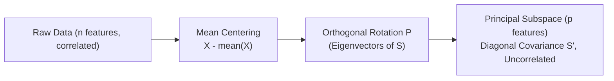

# ML4N — Part 4: Dimensionality Reduction
**Course:** Machine Learning for Networking (ML4N)  
**Instructor:** Prof. Luca Vassio (Politecnico di Torino)  
**Source Slides:** `4_ML4N_DimensionalityReduction.pdf` (78 slides)  
**Purpose:** Optimized knowledge context for Claude / LLMs (noise-free, complete LaTeX formulas, consolidated slide animations, visual diagram descriptions, and worked quiz solutions).

---

## Table of Contents
1. [Motivation & Dimensionality Reduction Taxonomy](#1-motivation--dimensionality-reduction-taxonomy)
2. [Linear Algebra & Matrix Preliminaries](#2-linear-algebra--matrix-preliminaries)
3. [Variance, Covariance & The Covariance Matrix](#3-variance-covariance--the-covariance-matrix)
4. [Principal Component Analysis (PCA) — Concepts & Formulations](#4-principal-component-analysis-pca--concepts--formulations)
5. [Mathematical Derivation of PCA (Step-by-Step)](#5-mathematical-derivation-of-pca-step-by-step)
6. [The Complete PCA Algorithm](#6-the-complete-pca-algorithm)
7. [Eigenvalues, Scree Plots & Stopping Criteria](#7-eigenvalues-scree-plots--stopping-criteria)
8. [Data Reconstruction & Compression (Eigenfaces Example)](#8-data-reconstruction--compression-eigenfaces-example)
9. [Kernel PCA (Non-Linear PCA)](#9-kernel-pca-non-linear-pca)
10. [t-SNE (t-Distributed Stochastic Neighbor Embedding)](#10-t-sne-t-distributed-stochastic-neighbor-embedding)
11. [Comparative Synthesis: PCA vs. t-SNE](#11-comparative-synthesis-pca-vs-t-sne)
12. [Self-Assessment Quiz (With Full Solutions)](#12-self-assessment-quiz-with-full-solutions)
13. [Readings & Acknowledgments](#13-readings--acknowledgments)

---

## 1. Motivation & Dimensionality Reduction Taxonomy
> 📍 *Reference: Slides 2–4, 13–20*

### Why Reduce Dimensionality?
Modern networking datasets (e.g., per-flow packet statistics, DPI features, routing tables) often possess dozens to thousands of attributes. High dimensionality introduces several problems:
1. **Curse of Dimensionality:** Data points become extremely sparse; Euclidean distances between points concentrate and become indistinguishable.
2. **Computational Overhead:** Algorithms with complexity $O(m n^2)$ or $O(n^3)$ slow down drastically.
3. **Multicollinearity & Redundancy:** Correlated features increase model parameter variance without adding new information.
4. **Visualization Limits:** Human perception is constrained to $\le 3$ dimensions.

The goal is to find a mapping function $h: \mathbb{R}^n \to \mathbb{R}^p$ (where $p \ll n$) that maximally compresses raw data while preserving the essential variance and structure required for accurate downstream reconstruction or classification.

---

### Taxonomy of Dimensionality Reduction Techniques
> 📍 *Reference: Slide 20*

| Technique | Linearity | Supervision | Primary Objective |
| :--- | :--- | :--- | :--- |
| **SVD** (Singular Value Decomposition) | Linear | Unsupervised | Matrix factorization & low-rank approximation |
| **PCA** (Principal Component Analysis) | Linear | Unsupervised | Maximizes projected variance / minimizes reconstruction error |
| **LDA** (Linear Discriminant Analysis) | Linear | Supervised | Maximizes between-class variance relative to within-class variance |
| **Kernel PCA** | Non-Linear | Unsupervised | Performs linear PCA in a high-dimensional kernel Hilbert space |
| **t-SNE** | Non-Linear | Unsupervised | Preserves local probabilistic neighbor distributions for 2D/3D visualization |
| **UMAP** | Non-Linear | Unsupervised | Preserves both local and global manifold topology |

---

## 2. Linear Algebra & Matrix Preliminaries
> 📍 *Reference: Slides 5, 10–12*

### Matrix Transpose Properties
For conforming matrices $\mathbf{A}, \mathbf{B}$ and scalar $c$:
- $(\mathbf{A}^T)^T = \mathbf{A}$
- $(\mathbf{A} \pm \mathbf{B})^T = \mathbf{A}^T \pm \mathbf{B}^T$
- $(c\mathbf{A})^T = c\mathbf{A}^T$
- $(\mathbf{A}\mathbf{B})^T = \mathbf{B}^T \mathbf{A}^T$ *(order reverses)*

### Orthogonality & Orthonormality
- Two vectors $\mathbf{u}_1, \mathbf{u}_2 \in \mathbb{R}^n$ are **orthogonal** if their inner product is zero:
  $$\mathbf{u}_1^T \mathbf{u}_2 = 0$$
- They are **orthonormal** if they are orthogonal and have unit length ($\|\mathbf{u}_i\|_2 = 1$):
  $$\mathbf{u}_1^T \mathbf{u}_1 = 1, \quad \mathbf{u}_2^T \mathbf{u}_2 = 1, \quad \mathbf{u}_1^T \mathbf{u}_2 = 0$$
- An $n \times n$ matrix $\mathbf{P}$ whose rows and columns are mutually orthonormal vectors is an **orthogonal (orthonormal) matrix**:
  $$\mathbf{P}^{-1} = \mathbf{P}^T \iff \mathbf{P} \mathbf{P}^T = \mathbf{P}^T \mathbf{P} = \mathbf{I}$$

### Eigenvalues & Eigenvectors
For an $n \times n$ square matrix $\mathbf{A}$, a non-zero vector $\mathbf{u} \in \mathbb{R}^n$ is an **eigenvector** with corresponding **eigenvalue** $\lambda$ if:

$$\mathbf{A}\mathbf{u} = \lambda \mathbf{u} \iff (\mathbf{A} - \lambda \mathbf{I})\mathbf{u} = \mathbf{0}$$

**Computation:**
1. Characteristic Equation: Solve the degree-$n$ polynomial $\det(\mathbf{A} - \lambda \mathbf{I}) = 0$ to obtain $n$ eigenvalues $\lambda_1, \dots, \lambda_n$.
2. For each $\lambda_i$, solve the homogeneous linear system $(\mathbf{A} - \lambda_i \mathbf{I})\mathbf{u}_i = \mathbf{0}$ to find the corresponding eigenvector $\mathbf{u}_i$.
3. **Spectral Theorem for Real Symmetric Matrices:** If $\mathbf{A} = \mathbf{A}^T$ (such as a covariance matrix), all eigenvalues $\lambda_i$ are real, and eigenvectors corresponding to distinct eigenvalues are mutually orthogonal.

---

## 3. Variance, Covariance & The Covariance Matrix
> 📍 *Reference: Slides 6–9*

Given dataset $\mathbf{X}$ with $m$ samples and $n$ attributes:

### Univariate Variance ($n = 1$)
Measures data spread around the mean $\bar{x}$:
$$s^2 = \text{var}(\mathbf{x}) = \frac{1}{m-1} \sum_{i=1}^m (x_i - \bar{x})^2$$

### Bivariate Covariance ($n = 2$)
Measures joint linear variation between features $\mathbf{x}$ and $\mathbf{y}$:
$$\text{cov}(\mathbf{x}, \mathbf{y}) = \frac{1}{m-1} \sum_{i=1}^m (x_i - \bar{x})(y_i - \bar{y})$$
- $\text{cov}(\mathbf{x}, \mathbf{y}) = 0$: Variables are linearly uncorrelated.
- $\text{cov}(\mathbf{x}, \mathbf{y}) > 0$: Variables move in the same direction.
- $\text{cov}(\mathbf{x}, \mathbf{y}) < 0$: Variables move in opposite directions.

### The Sample Covariance Matrix $\mathbf{S}$ ($n \times n$)
Contains pairwise covariances between all $n$ features:

$$\mathbf{S} = \begin{bmatrix} \text{cov}(\mathbf{x}_1, \mathbf{x}_1) & \text{cov}(\mathbf{x}_1, \mathbf{x}_2) & \cdots & \text{cov}(\mathbf{x}_1, \mathbf{x}_n) \\ \text{cov}(\mathbf{x}_2, \mathbf{x}_1) & \text{cov}(\mathbf{x}_2, \mathbf{x}_2) & \cdots & \text{cov}(\mathbf{x}_2, \mathbf{x}_n) \\ \vdots & \vdots & \ddots & \vdots \\ \text{cov}(\mathbf{x}_n, \mathbf{x}_1) & \text{cov}(\mathbf{x}_n, \mathbf{x}_2) & \cdots & \text{cov}(\mathbf{x}_n, \mathbf{x}_n) \end{bmatrix}$$

**Matrix Form:**
$$\mathbf{S} = \frac{1}{m - 1} (\mathbf{X} - \overline{\mathbf{X}})^T (\mathbf{X} - \overline{\mathbf{X}})$$
Where $\overline{\mathbf{X}}$ is the $m \times n$ mean matrix (each row is identical, containing feature means $[\bar{x}_1, \dots, \bar{x}_n]$).
- If $\mathbf{X}$ is already centered ($\overline{\mathbf{X}} = \mathbf{0}$):
  $$\mathbf{S} = \frac{1}{m - 1} \mathbf{X}^T \mathbf{X}$$
- $\mathbf{S}$ is symmetric: $\mathbf{S} = \mathbf{S}^T$.
- Diagonal elements $S_{ii} = \sigma_i^2$ are individual feature variances.
- Off-diagonal elements $S_{ij} = \text{cov}(\mathbf{x}_i, \mathbf{x}_j)$ are cross-feature covariances.

---

## 4. Principal Component Analysis (PCA) — Concepts & Formulations
> 📍 *Reference: Slides 21–34*

### Historical Origins
Introduced by Karl Pearson (1901) and independently developed by Harold Hotelling (1933) to describe multivariate data variation using a minimal set of uncorrelated linear components.

### Bishop's Dual Definitions of PCA
> 📍 *Reference: Slide 32 (C.M. Bishop, Pattern Recognition and Machine Learning)*

PCA can be defined through two equivalent mathematical perspectives:
1. **Maximum Variance Formulation:** An orthogonal linear projection of data points onto a lower-dimensional linear subspace such that the variance of the projected data points is maximized.
2. **Minimum Reconstruction Error Formulation:** A linear projection that minimizes the sum-of-squares of projection errors (orthogonal Euclidean residuals between the original points and their projections).

---

## 5. Mathematical Derivation of PCA (Step-by-Step)
> 📍 *Reference: Slides 35–41*

### The Objective
Given zero-mean data matrix $\mathbf{X}$ ($m \times n$), we seek an orthonormal transformation matrix $\mathbf{P}$ ($n \times n$) such that the transformed coordinates:

$$\mathbf{X}' = \mathbf{X}\mathbf{P}^T$$

Have a **diagonalized covariance matrix** $\mathbf{S}' = \text{cov}(\mathbf{X}')$ (meaning all new features are mutually uncorrelated).

---

### Proof of Covariance Diagonalization
1. Write the covariance of the projected data $\mathbf{X}'$:
   $$\text{cov}(\mathbf{X}') = \frac{1}{m - 1} (\mathbf{X}')^T (\mathbf{X}')$$
2. Substitute $\mathbf{X}' = \mathbf{X}\mathbf{P}^T$:
   $$\text{cov}(\mathbf{X}') = \frac{1}{m - 1} (\mathbf{X}\mathbf{P}^T)^T (\mathbf{X}\mathbf{P}^T) = \frac{1}{m - 1} \mathbf{P} \mathbf{X}^T \mathbf{X} \mathbf{P}^T$$
3. Define $\mathbf{A} = \mathbf{X}^T \mathbf{X}$. Since $\mathbf{A}$ is a real symmetric $n \times n$ matrix, the Spectral Theorem guarantees that $\mathbf{A}$ can be factorized into its orthonormal eigenvector matrix $\mathbf{E}$ and diagonal eigenvalue matrix $\mathbf{D}$:
   $$\mathbf{A} = \mathbf{E} \mathbf{D} \mathbf{E}^T$$
4. Choose the transformation matrix $\mathbf{P}$ to be the transpose of the eigenvector matrix $\mathbf{E}$:
   $$\mathbf{P} := \mathbf{E}^T \iff \mathbf{P}^T = \mathbf{E}$$
5. Substitute $\mathbf{A} = \mathbf{P}^T \mathbf{D} \mathbf{P}$ back into the covariance equation:
   $$\text{cov}(\mathbf{X}') = \frac{1}{m - 1} \mathbf{P} (\mathbf{P}^T \mathbf{D} \mathbf{P}) \mathbf{P}^T$$
6. Because $\mathbf{P}$ is orthonormal, $\mathbf{P}\mathbf{P}^T = \mathbf{P}\mathbf{P}^{-1} = \mathbf{I}$:
   $$\text{cov}(\mathbf{X}') = \frac{1}{m - 1} (\mathbf{P}\mathbf{P}^T) \mathbf{D} (\mathbf{P}\mathbf{P}^T) = \frac{1}{m - 1} \mathbf{I} \mathbf{D} \mathbf{I} = \frac{1}{m - 1} \mathbf{D}$$

$$\mathbf{S}' = \text{cov}(\mathbf{X}') = \frac{1}{m - 1} \mathbf{D} = \begin{bmatrix} \frac{\lambda_1}{m-1} & 0 & \cdots & 0 \\ 0 & \frac{\lambda_2}{m-1} & \cdots & 0 \\ \vdots & \vdots & \ddots & \vdots \\ 0 & 0 & \cdots & \frac{\lambda_n}{m-1} \end{bmatrix}$$

**Conclusion:** 
- The covariance matrix of $\mathbf{X}'$ is **strictly diagonal**.
- All cross-covariances are 0 (uncorrelated).
- The variance along the $i$-th principal component is directly proportional to eigenvalue $\lambda_i$.
- The principal components are the rows of $\mathbf{P}$ (the eigenvectors of $\mathbf{X}^T \mathbf{X}$, or equivalently the eigenvectors of covariance matrix $\mathbf{S}$).

---

### Proof Sketch via Lagrange Multipliers ($p = 1$)
To find the single unit vector $\mathbf{u}_1$ ($\|\mathbf{u}_1\|_2 = 1$) that maximizes projected variance:
$$\max_{\mathbf{u}_1} \mathbf{u}_1^T \mathbf{S} \mathbf{u}_1 \quad \text{subject to } \mathbf{u}_1^T \mathbf{u}_1 = 1$$

Construct the Lagrangian:
$$\mathcal{L}(\mathbf{u}_1, \lambda_1) = \mathbf{u}_1^T \mathbf{S} \mathbf{u}_1 - \lambda_1 (\mathbf{u}_1^T \mathbf{u}_1 - 1)$$

Take the derivative with respect to $\mathbf{u}_1$ and set to zero:
$$\frac{\partial \mathcal{L}}{\partial \mathbf{u}_1} = 2\mathbf{S}\mathbf{u}_1 - 2\lambda_1 \mathbf{u}_1 = \mathbf{0} \implies \mathbf{S}\mathbf{u}_1 = \lambda_1 \mathbf{u}_1$$

This is the exact eigenvector equation! Multiplying both sides by $\mathbf{u}_1^T$:
$$\mathbf{u}_1^T \mathbf{S} \mathbf{u}_1 = \lambda_1 \mathbf{u}_1^T \mathbf{u}_1 = \lambda_1$$
To maximize the projected variance, $\mathbf{u}_1$ must be the eigenvector corresponding to the **largest eigenvalue** $\lambda_1$. Successive orthogonal components are derived by induction.

---

## 6. The Complete PCA Algorithm
> 📍 *Reference: Slides 43–44*

Given dataset $\mathbf{X}_{m \times n}$ and target dimensions $p < n$:

1. **Center the Data:**
   Compute feature means $\bar{x}_j = \frac{1}{m} \sum_{i=1}^m x_{ij}$ and subtract:
   $$\widetilde{\mathbf{X}} = \mathbf{X} - \overline{\mathbf{X}}$$
2. **Standardize (Critical Step):**
   If features have different physical units or variances, divide by sample standard deviation:
   $$\widetilde{x}_{ij} \leftarrow \frac{x_{ij} - \bar{x}_j}{s_j}$$
   *(Otherwise, high-variance variables dominate the first principal component solely due to scale).*
3. **Compute Sample Covariance Matrix $\mathbf{S}$:**
   $$\mathbf{S} = \frac{1}{m - 1} \widetilde{\mathbf{X}}^T \widetilde{\mathbf{X}}$$
4. **Eigendecomposition:**
   Compute eigenvalues $\lambda_1, \dots, \lambda_n$ and eigenvectors $\mathbf{u}_1, \dots, \mathbf{u}_n$ satisfying $\mathbf{S}\mathbf{u}_i = \lambda_i \mathbf{u}_i$.
5. **Sort Eigenpairs:**
   Order eigenvalues descending: $\lambda_1 \ge \lambda_2 \ge \cdots \ge \lambda_n \ge 0$.
6. **Form Projection Matrix $\mathbf{P}_p$:**
   Stack the top $p$ eigenvectors as rows of matrix $\mathbf{P}_p$ ($p \times n$):
   $$\mathbf{P}_p = \begin{bmatrix} \mathbf{u}_1^T \\ \mathbf{u}_2^T \\ \vdots \\ \mathbf{u}_p^T \end{bmatrix}$$
7. **Project Data:**
   $$\mathbf{X}' = \widetilde{\mathbf{X}} \mathbf{P}_p^T \quad (m \times p)$$

---

## 7. Eigenvalues, Scree Plots & Stopping Criteria
> 📍 *Reference: Slides 45–50*

### Explained Variance Ratio
The percentage of total dataset variance explained by component $i$ is:

$$V_i = 100 \times \frac{\lambda_i}{\sum_{j=1}^n \lambda_j}$$

For standardized data, the sum of eigenvalues equals the total number of features:
$$\sum_{j=1}^n \lambda_j = n$$

---

### Criteria for Choosing $p$ (Number of Components)
1. **Cumulative Variance Threshold:** Retain enough components so cumulative explained variance exceeds a domain target (e.g., $\ge 80\%$ or $\ge 90\%$):
   $$\sum_{i=1}^p V_i \ge \text{Threshold}$$
2. **Kaiser Criterion:** Retain only components with eigenvalues $\lambda_i > 1$ (applicable to standardized data). Rationale: A component with $\lambda_i < 1$ explains less variance than a single original standardized feature.
3. **Elbow Method (Scree Plot):** Plot eigenvalues $\lambda_i$ vs. component index $i$. Locate the "elbow" (point of inflection where the curve flattens into an "erosion scree"); keep all components preceding the elbow.

---

## 8. Data Reconstruction & Compression (Eigenfaces Example)
> 📍 *Reference: Slides 51–60*

### Reconstruction Formula
Original data can be approximated from the $p$-dimensional compressed scores:

$$\widehat{\mathbf{X}} = \mathbf{X}' \mathbf{P}_p + \overline{\mathbf{X}}$$

In transposed form:
$$\widehat{\mathbf{X}}^T = \mathbf{P}_p^T (\mathbf{X}')^T + \overline{\mathbf{X}}^T$$
- $\mathbf{X}^T$ is $n \times m$ ($m$ observations of length $n$).
- $\mathbf{P}_p^T$ is $n \times p$ ($p$ basis vectors).
- $(\mathbf{X}')^T$ is $p \times m$ ($p$ coordinates per sample).

### Concrete Application: Image Compression (Eigenfaces)
- **Problem Setup:** $m = 32$ facial images, each of size $321 \times 261 = 83,781$ pixels.
- Raw dimension: $n = 83,781$.
- Observations: $m = 32 \ll n = 83,781$ (high-dimensional, low-sample-size setting).
- **Result:**
  - The top $p = 4$ eigenvectors (termed **eigen-images** or **eigenfaces** when reshaped back to $321 \times 261$) capture the predominant facial structures (lighting, face contours, features).
  - Reconstructing all 32 faces using only $p = 4$ scalars per image yields identifiable approximations, compressing the representation by a factor of:
    $$\frac{83,781}{4} \approx 20,945\times$$

---

## 9. Kernel PCA (Non-Linear PCA)
> 📍 *Reference: Slides 61–65*

### The Limitation of Linear PCA
Standard PCA only finds linear orthogonal subspaces. If data lies on a curved, non-linear manifold (e.g., concentric circles, spirals, or Swiss roll), linear projections conflate distinct classes and fail to capture the manifold structure.

### The Kernel Trick
1. Map original data non-linearly into an arbitrary high-dimensional feature space $\mathcal{F}$ via function $\phi(\mathbf{x})$:
   $$\mathbf{x} \in \mathbb{R}^n \xrightarrow{\phi} \phi(\mathbf{x}) \in \mathcal{F}$$
2. Perform standard linear PCA inside the feature space $\mathcal{F}$.
3. By Mercer's theorem, we do not need to compute $\phi(\mathbf{x})$ explicitly. We only need the inner product defined by a **Kernel function** $K(\mathbf{x}_i, \mathbf{x}_j) = \phi(\mathbf{x}_i)^T \phi(\mathbf{x}_j)$:
   - Radial Basis Function (RBF / Gaussian): $K(\mathbf{x}_i, \mathbf{x}_j) = \exp(-\gamma \|\mathbf{x}_i - \mathbf{x}_j\|^2)$
   - Polynomial Kernel: $K(\mathbf{x}_i, \mathbf{x}_j) = (\mathbf{x}_i^T \mathbf{x}_j + c)^d$
4. Linear principal components in $\mathcal{F}$ correspond to non-linear principal manifolds in the original data space $\mathbb{R}^n$.

---

## 10. t-SNE (t-Distributed Stochastic Neighbor Embedding)
> 📍 *Reference: Slides 66–73*

### Foundational Concept
Introduced by Laurens van der Maaten and Geoffrey Hinton (2008), **t-SNE** is an unsupervised, non-linear technique designed specifically to visualize high-dimensional datasets in 2D or 3D.

### Two-Stage Probabilistic Framework

#### Stage 1: High-Dimensional Affinities (Gaussian)
The similarity of data point $\mathbf{x}_j$ to point $\mathbf{x}_i$ is modeled as conditional probability under a Gaussian distribution:

$$p_{j|i} = \frac{\exp\left( -\|\mathbf{x}_i - \mathbf{x}_j\|^2 / 2\sigma_i^2 \right)}{\sum_{k \neq i} \exp\left( -\|\mathbf{x}_i - \mathbf{x}_k\|^2 / 2\sigma_i^2 \right)}, \quad p_{i|i} = 0$$

Symmetric joint probability:
$$p_{ij} = \frac{p_{j|i} + p_{i|j}}{2m}$$

#### Stage 2: Low-Dimensional Affinities (Student-$t$)
In the 2D/3D map, pairwise similarities between points $\mathbf{y}_i, \mathbf{y}_j$ are modeled using a **Student-$t$ distribution with 1 degree of freedom (Cauchy distribution)**:

$$q_{ij} = \frac{\left( 1 + \|\mathbf{y}_i - \mathbf{y}_j\|^2 \right)^{-1}}{\sum_{k} \sum_{l \neq k} \left( 1 + \|\mathbf{y}_k - \mathbf{y}_l\|^2 \right)^{-1}}, \quad q_{ii} = 0$$

#### Why the Student-$t$ Distribution? (The Crowding Problem)
In high dimensions, the volume of a sphere expands exponentially. When projecting onto a 2D plane, there is insufficient area to preserve both small local neighborhood distances and moderate pairwise distances, causing disparate points to "crowd" together into the center.
The Student-$t$ distribution has **heavy tails** ($q_{ij} \propto \frac{1}{\|\mathbf{y}_i - \mathbf{y}_j\|^2}$ instead of $e^{-\|\mathbf{y}\|^2}$). This allows points that are moderately distant in high dimensions to be placed far apart in 2D without distorting local cluster neighborhoods.

#### Stage 3: Optimization via KL Divergence
Points $\mathbf{y}_i$ are arranged by minimizing the Kullback-Leibler (KL) divergence between $P$ and $Q$ via gradient descent:

$$\text{KL}(P \parallel Q) = \sum_{i \neq j} p_{ij} \log \frac{p_{ij}}{q_{ij}}$$

---

### Hyperparameters & Crucial Caveats
- **Perplexity:** Effectively controls the number of nearest neighbors considered when setting $\sigma_i$. Typical default range: $5$ to $50$.
- **Complexity:** Standard t-SNE scales as $O(m^2)$ time and memory; Barnes-Hut approximation reduces this to $O(m \log m)$.
- **Pitfalls in Visual Interpretation:**
  1. *Cluster Size:* Cluster sizes in t-SNE plots do not reflect variance or cluster volume in the original space.
  2. *Inter-Cluster Distance:* Distances between separate clusters in a t-SNE plot are essentially arbitrary and should not be interpreted as physical similarity.
  3. *Non-Parametric:* t-SNE does not learn an explicit projection matrix; you cannot directly project a new unseen test point without recalculating the embedding.

---

## 11. Comparative Synthesis: PCA vs. t-SNE
> 📍 *Reference: Slides 70–73*

| Evaluation Dimension | PCA (Principal Component Analysis) | t-SNE (t-Distributed Stochastic Neighbor Embedding) |
| :--- | :--- | :--- |
| **Model Type** | Linear, deterministic | Non-linear, probabilistic / stochastic |
| **Optimization Target** | Maximizes global variance (large pairwise distances) | Preserves local neighbor affinities (small pairwise distances) |
| **Reversibility** | Fully invertible ($\widehat{\mathbf{X}} = \mathbf{X}' \mathbf{P} + \overline{\mathbf{X}}$) | Non-invertible (no analytic inverse or out-of-sample mapping) |
| **Reproducibility** | Exact, identical output every run | Varies across runs unless random seed is fixed |
| **Computational Complexity** | $O(n^3 + m n^2)$ | $O(m^2)$ (or $O(m \log m)$ with Barnes-Hut) |
| **Interpretable Dimensions** | Principal components are linear combinations of features | Transformed axes have no direct physical or feature interpretation |
| **Primary Use Cases** | Feature reduction for ML models, noise filtering, compression | 2D / 3D exploratory cluster visualization |

---

## 12. Self-Assessment Quiz (With Full Solutions)
> 📍 *Reference: Slide 75*

### Problem Statement
Given 5 data samples with 4 features:

$$\mathbf{X} = \begin{bmatrix} 1 & 2 & 3 & 4 \\ 5 & 5 & 6 & 7 \\ 1 & 4 & 2 & 3 \\ 5 & 3 & 2 & 1 \\ 8 & 1 & 2 & 2 \end{bmatrix}$$

1. Compute the sample mean vector $\bar{\mathbf{x}}$ and center the data matrix.
2. Compute the sample covariance matrix $\mathbf{S}$.
3. Compute the eigenvalues and the percentage of explained variance for all 4 principal components.
4. Compute the principal component eigenvectors.

---

### Step-by-Step Solutions

#### 1. Mean Vector & Centering
- Column means ($m = 5$):
  $$\bar{\mathbf{x}} = \left[ \frac{1+5+1+5+8}{5}, \; \frac{2+5+4+3+1}{5}, \; \frac{3+6+2+2+2}{5}, \; \frac{4+7+3+1+2}{5} \right] = [4.0, \; 3.0, \; 3.0, \; 3.4]$$
- Centered Matrix $\widetilde{\mathbf{X}} = \mathbf{X} - \bar{\mathbf{x}}$:
  $$\widetilde{\mathbf{X}} = \begin{bmatrix} -3.0 & -1.0 & 0.0 & +0.6 \\ +1.0 & +2.0 & +3.0 & +3.6 \\ -3.0 & +1.0 & -1.0 & -0.4 \\ +1.0 & 0.0 & -1.0 & -2.4 \\ +4.0 & -2.0 & -1.0 & -1.4 \end{bmatrix}$$

---

#### 2. Sample Covariance Matrix $\mathbf{S}$
Using $\mathbf{S} = \frac{1}{m-1} \widetilde{\mathbf{X}}^T \widetilde{\mathbf{X}}$ with $m - 1 = 4$:

$$\mathbf{S} = \begin{bmatrix} 9.00 & -3.25 & -1.75 & -2.45 \\ -3.25 & 2.50 & 1.25 & 1.55 \\ -1.75 & 1.25 & 3.00 & 3.05 \\ -2.45 & 1.55 & 3.05 & 5.30 \end{bmatrix}$$

Total variance (trace of $\mathbf{S}$):
$$\text{Tr}(\mathbf{S}) = 9.00 + 2.50 + 3.00 + 5.30 = \mathbf{19.80}$$

---

#### 3. Eigenvalues & Explained Variance
Solving $\det(\mathbf{S} - \lambda \mathbf{I}) = 0$ yields 4 real positive eigenvalues:
- $\lambda_1 \approx \mathbf{10.6066}$
- $\lambda_2 \approx \mathbf{7.9081}$
- $\lambda_3 \approx \mathbf{1.1906}$
- $\lambda_4 \approx \mathbf{0.0947}$

Sum of eigenvalues:
$$\sum_{j=1}^4 \lambda_j = 10.6066 + 7.9081 + 1.1906 + 0.0947 = 19.80 = \text{Tr}(\mathbf{S})$$

**Percentage of Explained Variance ($V_i = 100 \times \frac{\lambda_i}{19.80}$):**
- **PC1:** $V_1 = 100 \times \frac{10.6066}{19.80} \approx \mathbf{53.57\%}$
- **PC2:** $V_2 = 100 \times \frac{7.9081}{19.80} \approx \mathbf{39.94\%}$
- **PC3:** $V_3 = 100 \times \frac{1.1906}{19.80} \approx \mathbf{6.01\%}$
- **PC4:** $V_4 = 100 \times \frac{0.0947}{19.80} \approx \mathbf{0.48\%}$

> [!TIP]
> Notice that the first two principal components together explain:
> $$V_1 + V_2 = 53.57\% + 39.94\% = \mathbf{93.51\%}$$
> of the total variance! Reducing the dataset from 4 dimensions to 2 dimensions preserves over 93.5% of the information.

---

#### 4. Principal Component Eigenvectors
The orthonormal eigenvectors (columns correspond to $\mathbf{u}_1, \mathbf{u}_2, \mathbf{u}_3, \mathbf{u}_4$):

$$\mathbf{E} = \begin{bmatrix} \mathbf{u}_1 & \mathbf{u}_2 & \mathbf{u}_3 & \mathbf{u}_4 \end{bmatrix} = \begin{bmatrix} +0.6948 & -0.6989 & -0.1134 & -0.1262 \\ -0.3482 & -0.1704 & -0.9082 & -0.1577 \\ -0.3234 & -0.4800 & +0.0730 & +0.8122 \\ -0.5398 & -0.5021 & +0.3962 & -0.5473 \end{bmatrix}$$

---

## 13. Readings & Acknowledgments
> 📍 *Reference: Slides 76–77*
- **Readings:**
  - Tan, Steinbach, Kumar, *Introduction to Data Mining*, McGraw Hill (2006) — Chapters 9 & 12.
  - C.M. Bishop, *Pattern Recognition and Machine Learning*, Springer.
  - Wattenberg, et al., "How to Use t-SNE Effectively", *Distill* (2016).
- **Slide Acknowledgments:**
  - Prof. Kristel Van Steen (Université de Liège)
  - Prof. Aidong Zhang (University at Buffalo)
  - PICASso Group (Princeton University)
  - Prof. Václav Hlaváč (Czech Technical University in Prague)
