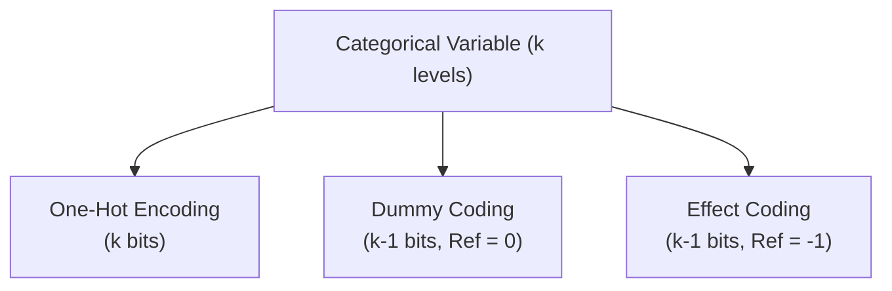
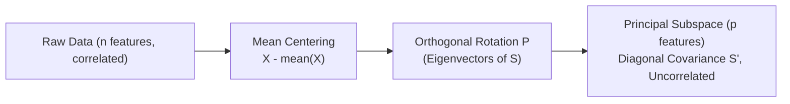

# ML4N: Machine Learning for Networking — Comprehensive Theory Knowledge Base
> **Course:** Machine Learning for Networking (ML4N)  
> **Institution:** Politecnico di Torino  
> **Instructor:** Prof. Luca Vassio  
> **Scope:** Lectures 2, 3, and 4 (Data Exploration, Preprocessing, and Dimensionality Reduction)  
> **Document Purpose:** Complete, authoritative, noise-free Markdown knowledge base optimized for ingestion into Claude (Projects, Workbench, or Chat attachments).

---

## Instructions for Claude (Context Prompting Guide)
When reasoning over this document:
1. **Slide Grounding:** Reference markers like `[Slide XX]` indicate original presentation locations. Use these when citing sources for specific definitions or proofs.
2. **Mathematical Precision:** All formulas are formatted in LaTeX (`$...$` and `$$...$$`). Retain these conventions when answering mathematical or algorithmic questions.
3. **Notation Consistency:**
   - $m$: Number of rows (samples, instances, records, objects).
   - $n$: Number of columns (features, attributes, dimensions).
   - $p$: Target reduced dimensionality ($p < n$).
   - $\mathbf{X}$: Data matrix of size $m \times n$.
   - $\mathbf{S}$: Sample covariance matrix of size $n \times n$.
4. **Visual Interpretations:** When the user asks about plots (e.g., boxplot whiskers vs normal tails, KDE bandwidth, scree plot elbow, t-SNE perplexity), refer to the detailed visual interpretations documented within each lecture.
5. **Exam Quizzes:** Fully worked step-by-step solutions to all end-of-lecture quizzes are provided at the conclusion of each section.

---

## Master Table of Contents
1. [Part 2: Data Exploration and Visualization](#ml4n--part-2-data-exploration-and-visualization)
   - Notation, Distributions, KDE, ECDF, Boxplots, Outliers (GESD, DBSCAN), Correlation (Pearson, Spearman)
2. [Part 3: Data Preprocessing](#ml4n--part-3-data-preprocessing)
   - Attribute Types, Distances (Minkowski, Mahalanobis, Cosine, Jaccard), Normalization (Min-Max, Z-Score), Encoding (One-Hot, Dummy, Effect), Text Preprocessing (BoW, TF-IDF)
3. [Part 4: Dimensionality Reduction](#ml4n--part-4-dimensionality-reduction)
   - Linear Algebra Foundations, Covariance Matrix, PCA Derivation & Algorithm, Explained Variance & Scree Plots, Kernel PCA, t-SNE & Perplexity

---

# ML4N — Part 2: Data Exploration and Visualization
**Course:** Machine Learning for Networking (ML4N)  
**Instructor:** Prof. Luca Vassio (Politecnico di Torino)  
**Source Slides:** `2_ML4N_DataExplorationVisualization.pdf` (74 slides)  
**Purpose:** Optimized knowledge context for Claude / LLMs (noise-free, complete LaTeX formulas, consolidated slide animations, visual diagram descriptions, and worked quiz solutions).

---

## Table of Contents
1. [Core Notation & Mathematical Preliminaries](#1-core-notation--mathematical-preliminaries)
2. [Dataset Representation & Dimensionality](#2-dataset-representation--dimensionality)
3. [Univariate Analysis & Probability Distributions](#3-univariate-analysis--probability-distributions)
4. [Kernel Density Estimation (KDE)](#4-kernel-density-estimation-kde)
5. [Empirical Cumulative Distribution Function (ECDF)](#5-empirical-cumulative-distribution-function-ecdf)
6. [Summary Statistics, Percentiles & Boxplots](#6-summary-statistics-percentiles--boxplots)
7. [Outlier Detection Techniques](#7-outlier-detection-techniques)
8. [Multivariate Analysis & Correlation](#8-multivariate-analysis--correlation)
9. [Advanced Visualization Techniques](#9-advanced-visualization-techniques)
10. [Key Takeaways & Best Practices](#10-key-takeaways--best-practices)
11. [Self-Assessment Quiz (With Full Solutions)](#11-self-assessment-quiz-with-full-solutions)
12. [Readings & Acknowledgments](#12-readings--acknowledgments)

---

## 1. Core Notation & Mathematical Preliminaries
> 📍 *Reference: Slides 2–6*

### High-Level Framing
Machine Learning fits mathematical models to observed data in order to make predictions or forecasts. Data exploration and visualization is the critical first step to understand distribution shapes, anomalies, scale disparities, and feature correlations.

### Set and Vector Notation
| Symbol | Mathematical Meaning | Notes / Context |
| :--- | :--- | :--- |
| $a \in \mathcal{A}$ | Element membership | Object $a$ is an element of set $\mathcal{A}$ |
| $|\mathcal{A}|$ | Cardinality | Number of elements in a finite set $\mathcal{A}$ |
| $\mathcal{A} \subseteq \mathcal{B}$ | Subset | Every element in $\mathcal{A}$ belongs to $\mathcal{B}$ |
| $\mathcal{A} \subset \mathcal{B}$ | Strict subset | $\mathcal{A} \subseteq \mathcal{B}$ and $\mathcal{A} \neq \mathcal{B}$ |
| $\mathbb{N}$ | Natural numbers | $\mathbb{N} = \{1, 2, 3, \dots\}$ |
| $\mathbb{R}$ | Real numbers | Continuous 1D number line |
| $\{0, 1\}$ | Binary set | Discrete domain consisting only of values 0 and 1 |
| $[0, 1]$ | Unit interval | Closed continuous real interval $\{x \in \mathbb{R} \mid 0 \le x \le 1\}$ |
| $\mathbf{x} = (x_1, \dots, x_n)^T$ | Column vector | Vector in $\mathbb{R}^n$; $j$-th entry is denoted $x_j$ |
| $\|\mathbf{x}\|$ or $\|\mathbf{x}\|_2$ | Euclidean ($L_2$) Norm | Length of vector: $\|\mathbf{x}\|_2 = \sqrt{\sum_{j=1}^n x_j^2}$ |

---

## 2. Dataset Representation & Dimensionality
> 📍 *Reference: Slides 8–10*

### Tabular Data Formalism
A dataset $\mathbf{X}$ is typically represented as an $m \times n$ matrix:
- **Rows ($m$):** Data objects, records, points, samples, entities, or instances.
- **Columns ($n$):** Attributes, features, variables, or dimensions.

$$\mathbf{X} = \begin{bmatrix} x_{11} & x_{12} & \cdots & x_{1n} \\ x_{21} & x_{22} & \cdots & x_{2n} \\ \vdots & \vdots & \ddots & \vdots \\ x_{m1} & x_{m2} & \cdots & x_{mn} \end{bmatrix}$$

### Impact of Dataset Scale
1. **Computational Bottleneck:** Algorithms with high computational complexity ($O(m^2)$, $O(m^3)$, or $O(n^3)$) fail or exhaust RAM when $m$ or $n$ is very large.
2. **Mitigation Strategies:**
   - **Data Sampling:** Reduces the row dimension ($m' < m$) while preserving representative population distributions.
   - **Feature Selection / Dimensionality Reduction:** Reduces the column dimension ($n' < n$) by pruning redundant or irrelevant attributes.

### Attribute Properties
For every attribute $j \in \{1, \dots, n\}$, data exploration requires verifying:
- **Unit of Measurement:** e.g., seconds, bytes, packets/s, ms.
- **Attribute Type:** Categorical (Nominal, Ordinal) vs. Numerical (Discrete, Continuous).
- **Domain Constraints:** Ensuring values respect theoretical and physical bounds (e.g., latency $\ge 0$, probability $\in [0, 1]$).
- **Analysis Scope:** Univariate (individual feature properties) vs. Multivariate (inter-feature relations).

---

## 3. Univariate Analysis & Probability Distributions
> 📍 *Reference: Slides 11–24*

### Theoretical vs. Empirical Distributions
- **Theoretical Distribution:** Mathematical model of a random variable $X$, defined by parameters (e.g., mean $\mu$, variance $\sigma^2$, skewness, kurtosis).
  - **Discrete:** Characterized by a **Probability Mass Function (PMF)**:
    $$P(X = x_k) = p_k, \quad \sum_k p_k = 1$$
  - **Continuous:** Characterized by a **Probability Density Function (PDF)** $f(x)$:
    $$P(a \le X \le b) = \int_a^b f(x) \, dx, \quad \int_{-\infty}^\infty f(x) \, dx = 1$$
  - **Cumulative Distribution Function (CDF):**
    $$F(x) = P(X \le x) = \int_{-\infty}^x f(t) \, dt$$
    By the Fundamental Theorem of Calculus:
    $$f(x) = \frac{d}{dx} F(x)$$
- **Empirical Distribution:** Constructed from $m$ observed sample points $\{x_1, x_2, \dots, x_m\}$ drawn from an unknown underlying theoretical distribution.
  - Sample Mean: $\bar{x} = \frac{1}{m} \sum_{i=1}^m x_i$
  - Sample Variance / Std: $s^2 = \frac{1}{m-1} \sum_{i=1}^m (x_i - \bar{x})^2$, $s = \sqrt{s^2}$
  - Shape metrics: Sample Skewness (asymmetry) and Sample Kurtosis (tailedness / extreme event propensity).

### Histograms & Binning
- Divides the range $[\min(x), \max(x)]$ into contiguous, non-overlapping intervals (bins).
- Counts occurrences (frequencies) within each bin.
- **Trade-offs:**
  - Bin width too large $\to$ Oversmoothing, loss of distribution modality (e.g., merging bimodal peaks).
  - Bin width too small $\to$ Undersmoothing, noisy spikes driven by random sampling fluctuations.
  - *Data Artifacts in Real Histograms:* Non-uniformity due to human rounding (e.g., birth weights or survey responses where integers or multiples of 5/10 are disproportionately frequent).

### PMF Limitations & Difference of Distributions
- Visualizing raw PMFs with many distinct discrete values or multiple groups becomes visually cluttered and difficult to compare.
- **Remedies:**
  - Plotting the **Difference of PMFs** ($\Delta p(x) = p_1(x) - p_2(x)$) in percentage points across bins to highlight relative shifts.
  - Using the **Cumulative Distribution Function (CDF)**.

---

## 4. Kernel Density Estimation (KDE)
> 📍 *Reference: Slides 25–35*

### Purpose
Kernel Density Estimation is a non-parametric method to estimate the continuous Probability Density Function $f(x)$ directly from $m$ discrete samples without assuming a strict parametric model (like pure Gaussian).

### Mathematical Formulation
The estimated density $\widehat{f}_h(x)$ at any point $x$ is the weighted average of kernel functions centered at each data sample $x_i$:

$$\widehat{f}_h(x) = \frac{1}{m} \sum_{i=1}^m K_h(x - x_i) = \frac{1}{mh} \sum_{i=1}^m K\left(\frac{x - x_i}{h}\right)$$

Where:
- $m$: Number of observed samples.
- $h > 0$: **Bandwidth** (smoothing parameter).
- $K(z)$: **Kernel function**, satisfying non-negativity $K(z) \ge 0$ and unit area $\int_{-\infty}^\infty K(z) \, dz = 1$.

### Gaussian Kernel
The most standard choice is the standard normal density $\mathcal{N}(0, 1)$:

$$K(z) = \frac{1}{\sqrt{2\pi}} e^{-\frac{z^2}{2}}$$

Substituting into the KDE equation:

$$\widehat{f}_h(x) = \frac{1}{m h \sqrt{2\pi}} \sum_{i=1}^m \exp\left( -\frac{(x - x_i)^2}{2 h^2} \right)$$

### Bandwidth Selection ($h$) & Visual Behavior
- **Under-smoothed ($h$ too small):** Individual kernels do not overlap sufficiently; curve is spiky and captures sampling noise as false local modes.
- **Over-smoothed ($h$ too large):** Kernels spread excessively; flattens the distribution and erases true multimodality or distinct structural features.
- **KDE vs. Histogram:**
  - KDE provides a continuous, differentiable, less cluttered curve.
  - *Caveat:* KDE can suffer from edge boundary bias if the true distribution has hard physical bounds (e.g., $x \ge 0$).

---

## 5. Empirical Cumulative Distribution Function (ECDF)
> 📍 *Reference: Slides 36–37*

### Definition
The ECDF $\widehat{F}(x)$ is an unbiased step function estimator of the true CDF:

$$\widehat{F}(x) = \frac{1}{m} \sum_{i=1}^m \mathbf{1}_{\{x_i \le x\}}$$

Where $\mathbf{1}_{\{x_i \le x\}}$ is the indicator function (1 if $x_i \le x$, else 0).

### Key Properties
- Starts at 0 for $x < \min(x_i)$ and steps up by exactly $1/m$ at each observed data point, reaching 1 at $\max(x_i)$.
- **Parameter-free:** Unlike histograms and KDE, ECDF requires **no binning or bandwidth parameter**, avoiding arbitrary visual distortion.
- **Visual Interpretation:**
  - **Steep / vertical sections:** High density of observations (modes).
  - **Flat / horizontal sections:** Low density or absence of data points.

---

## 6. Summary Statistics, Percentiles & Boxplots
> 📍 *Reference: Slides 38–40*

### Percentiles & Quartiles
- **$p$-th Percentile:** The value below which $p\%$ of observations fall.
- **Quartiles:**
  - $Q_1$ (25th percentile): Lower quartile.
  - $Q_2$ (50th percentile): Median ($\tilde{x}$).
  - $Q_3$ (75th percentile): Upper quartile.
- **Interquartile Range (IQR):**
  $$\text{IQR} = Q_3 - Q_1$$

### Anatomy of a Boxplot (Tukey Boxplot)
- **Central Box:** Spans from $Q_1$ to $Q_3$ (contains the middle 50% of the data).
- **Median Line:** Horizontal/vertical line inside the box at $Q_2$.
- **Whiskers:** Extend from $Q_1$ and $Q_3$ to the furthest data points within:
  - Lower bound: $Q_1 - 1.5 \times \text{IQR}$
  - Upper bound: $Q_3 + 1.5 \times \text{IQR}$
- **Outliers:** Any individual sample point falling strictly beyond the whisker bounds, plotted as distinct markers (dots).

### Correspondence with Gaussian / Normal Distribution
For normally distributed data $X \sim \mathcal{N}(\mu, \sigma^2)$:
- Median $= \mu = 0\sigma$
- $Q_1 \approx \mu - 0.6745\sigma$, $Q_3 \approx \mu + 0.6745\sigma$
- $\text{IQR} \approx 1.349\sigma$
- Whiskers span:
  $$[\mu - 2.698\sigma, \; \mu + 2.698\sigma]$$
- **Theoretical outlier probability under normality:**
  - The probability of falling within the whiskers is approximately **99.30%**.
  - Exactly **0.70%** (about 1 in 143 samples) are flagged as potential outliers by chance even when the data is purely Gaussian.

---

## 7. Outlier Detection Techniques
> 📍 *Reference: Slides 41–44*

### Nature of Outliers
Outliers represent extreme deviations caused by:
1. Measurement, recording, or sensor transmission errors.
2. Legitimate, critical rare events (e.g., cyberattacks, flash network traffic, system failures).
*Handling rule:* Treatment requires **domain knowledge**; naive deletion can remove the most important signals.

### Univariate Detection: GESD Test
The **Generalized Extreme Studentized Deviate (GESD)** test (generalized Grubbs test) detects up to an upper bound $k$ of outliers in univariate data assuming an underlying normal distribution.

**Test Statistic:**
$$R_r = \frac{\max_{i} |x_i - \bar{x}|}{s}$$
Where $\bar{x}$ and $s$ are the sample mean and sample standard deviation of the current dataset.

**Iterative Procedure:**
1. Compute $R_1$, identify the observation maximizing $|x_i - \bar{x}|$, and temporarily remove it.
2. Recompute $\bar{x}$, $s$, and $R_2$ on the remaining $m-1$ points.
3. Repeat up to $k$ iterations to obtain statistics $R_1, R_2, \dots, R_k$.
4. Compare each $R_r$ against critical value $\lambda_r$ computed from the Student's $t$-distribution. The number of outliers is the largest $r \le k$ such that $R_r > \lambda_r$.

### Multivariate Detection: DBSCAN
**Density-Based Spatial Clustering of Applications with Noise (DBSCAN):**
- Non-parametric, clustering-based outlier detector in $\mathbb{R}^n$.
- Uses two hyperparameters: $\varepsilon$ (neighborhood radius) and $\text{MinPts}$ (minimum points).
- Classifies points into Core points, Border points, and **Noise points (Outliers)**. Points in low-density regions that do not belong to any dense cluster are explicitly labeled as outliers (label $-1$).

---

## 8. Multivariate Analysis & Correlation
> 📍 *Reference: Slides 45–62*

### Visualizing Bivariate Relationships
- **Scatter Plot:** Visual inspection of relationship shape (linear, non-linear, monotonic, clustered).
- **Overplotting Mitigations:**
  - **Jittering:** Adding small uniform random noise to discrete/rounded coordinates to reveal overlapping point counts.
  - **Alpha Blending:** Adding transparency so darker regions reflect higher local point density.
  - **Hexbin Plot:** 2D histogram using hexagonal spatial bins colored by point frequency.
  - **Binned Percentile Plots:** Slicing variable $X$ into bins and plotting the 25th, 50th, and 75th percentiles of $Y$ per bin.

### Covariance & Pearson Correlation Coefficient
Given two variables $\mathbf{x}, \mathbf{y}$ across $m$ samples:
- **Sample Covariance:**
  $$s_{xy} = \text{cov}(\mathbf{x}, \mathbf{y}) = \frac{1}{m-1} \sum_{k=1}^m (x_k - \bar{x})(y_k - \bar{y})$$
  *Limitation:* Scale-dependent; magnitude depends on units of measurement.

- **Pearson Correlation Coefficient ($r$):**
  $$\text{corr}(\mathbf{x}, \mathbf{y}) = \frac{s_{xy}}{s_x s_y} = \frac{\sum_{k=1}^m (x_k - \bar{x})(y_k - \bar{y})}{\sqrt{\sum_{k=1}^m (x_k - \bar{x})^2} \sqrt{\sum_{k=1}^m (y_k - \bar{y})^2}}$$

**Properties of Pearson $r$:**
- Strictly bounded: $-1 \le r \le +1$.
- Measures **strictly linear** associations.
- Scale-invariant.
- **Pitfall:** Uncorrelated does not imply independent! A perfect non-linear symmetric relationship (e.g., $y = x^2$ for $x \in \{-3, -2, -1, 0, 1, 2, 3\}$) yields $r = 0$.

### Spearman's Rank Correlation ($r_s$)
Non-parametric correlation measuring **monotonic** relationships (whether variables increase/decrease together, regardless of linearity).

**Procedure:**
1. Convert raw scores $x_i, y_i$ into ranks $\mathrm{R}(x_i), \mathrm{R}(y_i) \in \{1, \dots, m\}$.
2. Compute the Pearson correlation on the ranks:
   $$r_s = \frac{\text{cov}(\mathrm{R}(x), \mathrm{R}(y))}{\sigma_{\mathrm{R}(x)} \sigma_{\mathrm{R}(y)}}$$
3. **Simplified Formula (when all $m$ ranks are distinct integers):**
   $$r_s = 1 - \frac{6 \sum_{i=1}^m d_i^2}{m(m^2 - 1)}, \quad d_i = \mathrm{R}(x_i) - \mathrm{R}(y_i)$$

**Key Comparison:**
- For any strictly increasing monotonic non-linear relation (e.g., $y = e^x$ or $y = x^3$ for $x > 0$), Spearman $r_s = 1.0$, whereas Pearson $r < 1.0$.

---

## 9. Advanced Visualization Techniques
> 📍 *Reference: Slides 63–70*

### Heatmaps
- 2D grid representing pairwise feature correlation matrices.
- Cell $(i, j)$ represents $\text{corr}(x_i, x_j)$; color saturation denotes correlation strength (e.g., red $= +1$, blue $= -1$). Matrix is symmetric along the diagonal.

### Word Clouds
- Visual representation of unstructured text / document terms.
- Font size and color are proportional to term frequency or TF-IDF importance.

### Dimensionality Reduction for 2D Projection
- **PCA (Principal Component Analysis):** Projects high-dimensional points onto top 2 orthogonal axes of maximal variance (e.g., Iris 4D $\to$ 2D).
- **t-SNE (t-Distributed Stochastic Neighbor Embedding):** Non-linear manifold embedding for cluster separation.
  - *Warning:* Distances between clusters in t-SNE are not preserved metrics and should not be used as raw input features for standard ML regressors without caution.

---

## 10. Key Takeaways & Best Practices
> 📍 *Reference: Slide 70*
1. Always explore raw data visually before fitting any machine learning model.
2. Select visualization tools aligned with data types (nominal $\to$ bar/frequency, continuous $\to$ KDE/ECDF, bivariate $\to$ scatter/hexbin).
3. Check for severe outliers and evaluate whether they represent noise or system anomalies.
4. Verify whether relationships are linear (Pearson) or monotonic non-linear (Spearman) before selecting regression models.

---

## 11. Self-Assessment Quiz (With Full Solutions)
> 📍 *Reference: Slide 72*

### Problem Statement
Given 12 observed samples:
$$\mathbf{x} = [0, 1, 1, 0, 5, 4.5, 7, 10, 0, 5, 6, -1]$$
$$\mathbf{y} = [5, 1, 7, 4, 9, 8, 7, 15, 5, 9, 9, 5]$$

1. Compute descriptive statistics for $\mathbf{x}$ (Sorted, Mean, Std, Median, Quartiles, IQR, Whiskers).
2. Determine if $\mathbf{x}$ contains boxplot outliers.
3. Compute the Pearson correlation coefficient $r(\mathbf{x}, \mathbf{y})$.
4. Compute the Spearman rank correlation coefficient $r_s(\mathbf{x}, \mathbf{y})$.

---

### Step-by-Step Solutions

#### 1. Distribution & Boxplot Statistics for $\mathbf{x}$
- **Sorted array ($m=12$):**
  $$\mathbf{x}_{\text{sorted}} = [-1.0, \; 0.0, \; 0.0, \; 0.0, \; 1.0, \; 1.0, \; 4.5, \; 5.0, \; 5.0, \; 6.0, \; 7.0, \; 10.0]$$
- **Sample Mean ($\bar{x}$):**
  $$\bar{x} = \frac{-1 + 0 + 0 + 0 + 1 + 1 + 4.5 + 5 + 5 + 6 + 7 + 10}{12} = \frac{38.5}{12} \approx 3.2083$$
- **Sample Standard Deviation ($s_x$, $ddof=1$):**
  $$s_x = \sqrt{\frac{1}{11} \sum_{i=1}^{12} (x_i - \bar{x})^2} \approx 3.4997$$
- **Median ($Q_2$):**
  Average of 6th and 7th elements: $\frac{1.0 + 4.5}{2} = 2.75$
- **Quartiles & IQR:**
  - $Q_1$ (25th percentile) $= 0.0$
  - $Q_3$ (75th percentile) $= 5.25$
  - $\text{IQR} = Q_3 - Q_1 = 5.25 - 0.0 = 5.25$
- **Whisker Thresholds ($1.5 \times \text{IQR}$):**
  - Lower boundary: $Q_1 - 1.5 \times \text{IQR} = 0 - 1.5(5.25) = -7.875$
  - Upper boundary: $Q_3 + 1.5 \times \text{IQR} = 5.25 + 1.5(5.25) = 13.125$

#### 2. Outlier Assessment
Since all samples in $\mathbf{x}$ lie in $[-1.0, 10.0]$, every sample satisfies:
$$-7.875 \le x_i \le 13.125$$
**Conclusion:** There are **no boxplot outliers** in dataset $\mathbf{x}$.

#### 3. Pearson Correlation $r(\mathbf{x}, \mathbf{y})$
- Mean of $\mathbf{y}$: $\bar{y} = \frac{84}{12} = 7.000$
- Sum of squared deviations: $\sum (x_i - \bar{x})^2 = 134.729$, $\sum (y_i - \bar{y})^2 = 134.000$
- Covariance numerator: $\sum (x_i - \bar{x})(y_i - \bar{y}) = 112.500$
- Correlation:
  $$r = \frac{112.500}{\sqrt{134.729 \times 134.000}} = \frac{112.500}{134.364} \approx \mathbf{0.8373}$$
**Interpretation:** Strong positive linear correlation.

#### 4. Spearman Rank Correlation $r_s(\mathbf{x}, \mathbf{y})$
Computing average ranks for tied values:
- Ranks for $\mathbf{x}$: $[3.0, 5.5, 5.5, 3.0, 8.5, 7.0, 11.0, 12.0, 3.0, 8.5, 10.0, 1.0]$
- Ranks for $\mathbf{y}$: $[4.0, 1.0, 7.5, 2.0, 10.5, 9.0, 7.5, 12.0, 4.0, 10.5, 10.5, 4.0]$
- Spearman correlation:
  $$r_s \approx \mathbf{0.7882}$$
**Interpretation:** Strong positive monotonic relationship.

---

## 12. Readings & Acknowledgments
> 📍 *Reference: Slides 73–74*
- **Readings:**
  - Tan, Steinbach, Kumar, *Introduction to Data Mining*, McGraw Hill (2006) — Chapters 1 & 9.
  - Allen B. Downey, *Think Stats*, O'Reilly.
  - Alice Zheng, Amanda Casari, *Feature Engineering for Machine Learning*, O'Reilly.
- **Acknowledgments:** Prof. Tania Cerquitelli and Prof. Elena Maria Baralis (Politecnico di Torino).

---

# ML4N — Part 3: Data Preprocessing
**Course:** Machine Learning for Networking (ML4N)  
**Instructor:** Prof. Luca Vassio (Politecnico di Torino)  
**Source Slides:** `3_ML4N_DataPreProcessing.pdf` (84 slides)  
**Purpose:** Optimized knowledge context for Claude / LLMs (noise-free, complete LaTeX formulas, consolidated slide animations, visual diagram descriptions, and worked quiz solutions).

---

## Table of Contents
1. [Introduction & Motivation](#1-introduction--motivation)
2. [Data Types & Attribute Properties](#2-data-types--attribute-properties)
3. [Dataset Formats & Structures](#3-dataset-formats--structures)
4. [Data Quality Issues & Remedies](#4-data-quality-issues--remedies)
5. [Similarity & Dissimilarity Metrics](#5-similarity--dissimilarity-metrics)
6. [Data Preprocessing Pipeline](#6-data-preprocessing-pipeline)
7. [Feature Transformation & Normalization](#7-feature-transformation--normalization)
8. [Discretization & Categorical Encoding](#8-discretization--categorical-encoding)
9. [Text Data Preprocessing & Representation](#9-text-data-preprocessing--representation)
10. [Self-Assessment Quiz (With Full Solutions)](#10-self-assessment-quiz-with-full-solutions)
11. [Readings & Acknowledgments](#11-readings--acknowledgments)

---

## 1. Introduction & Motivation
> 📍 *Reference: Slides 2–5*

Real-world datasets (especially network telemetry, packet captures, and server logs) are inherently imperfect:
- **Garbage In, Garbage Out:** High-performance machine learning models cannot compensate for noisy, biased, or poorly scaled training data.
- **Data Preprocessing** encompasses the full spectrum of operations that clean, transform, scale, select, and encode raw heterogeneous inputs into standardized numeric feature representations suitable for machine learning algorithms.

---

## 2. Data Types & Attribute Properties
> 📍 *Reference: Slides 6–10*

### Object and Attribute Duality
A dataset $\mathbf{X}$ is a collection of $m$ objects (rows) and $n$ attributes (columns).
- **Objects:** Also termed records, points, samples, cases, entities, or instances.
- **Attributes:** Also termed features, variables, dimensions, or fields.

### Hierarchy of Attribute Types
Attributes are categorized by the mathematical operations permissible on their values:

| Category | Attribute Type | Distinctness ($=, \neq$) | Order ($<, >$) | Addition ($+, -$) | Multiplication ($\times, /$) | Practical Examples |
| :--- | :--- | :---: | :---: | :---: | :---: | :--- |
| **Qualitative** (Categorical) | **Nominal** | Yes | No | No | No | IP protocol `{TCP, UDP, ICMP}`, eye color, postal zip code, hash values |
| **Qualitative** (Categorical) | **Ordinal** | Yes | Yes | No | No | QoS class `{Bronze, Silver, Gold}`, customer satisfaction `{1..5}`, rankings |
| **Quantitative** (Numeric) | **Interval** | Yes | Yes | Yes | No | Calendar dates, temperature in Celsius ($^\circ\text{C}$) or Fahrenheit ($^\circ\text{F}$) |
| **Quantitative** (Numeric) | **Ratio** | Yes | Yes | Yes | Yes | Absolute temperature (Kelvin), packet count, flow duration, byte throughput, delay |

> [!NOTE]
> **Interval vs. Ratio distinction:** Interval data lacks an absolute, non-arbitrary zero point (e.g., $0^\circ\text{C}$ does not mean absence of thermal energy; $20^\circ\text{C}$ is not "twice as hot" as $10^\circ\text{C}$). Ratio data possesses a true physical zero (0 bytes means no data transmitted; 200 packets is strictly twice 100 packets).

### Discrete vs. Continuous Attributes
- **Discrete:** Finite or countably infinite domain (e.g., integers, counts, binary flags, categorical labels). Often stored as integers or strings.
- **Continuous:** Uncountably infinite domain over real numbers $\mathbb{R}$ (e.g., signal-to-noise ratio, RTT, latency). Typically stored as floating-point numbers.

---

## 3. Dataset Formats & Structures
> 📍 *Reference: Slides 11–16*

1. **Tabular / Record Data:** Standard $m \times n$ matrix where each row is an independent instance with fixed feature columns.
2. **Document Data:** Unstructured text transformed into term vectors via bag-of-words or TF-IDF.
3. **Graph / Network Data:** Objects represented as nodes and pairwise relationships as edges (e.g., Internet topology, router graphs, social networks, adjacency matrices).
4. **Ordered Data:**
   - **Sequential Data:** Sequences of tokens or events where relative order matters (e.g., DNS query sequence).
   - **Time Series Data:** Continuous temporal measurements with explicit timestamps (e.g., bandwidth utilization per millisecond).
   - **Spatial Data:** Observations mapped to geographical or physical space (e.g., cell tower coordinates).

---

## 4. Data Quality Issues & Remedies
> 📍 *Reference: Slides 17–21*

### Common Quality Defects
1. **Noise:** Random distortion, variance, or background interference superimposed on legitimate measurements.
2. **Outliers:** Data objects possessing values drastically divergent from the remaining sample population.
3. **Missing Values:** Caused by sensor malfunction, dropped packets, non-mandatory input fields, or system timeouts.
4. **Duplicate Data:** Identical records or records with identical primary keys but contradictory feature values.

### Missing Data Handling Strategies
- **Record Elimination:** Drop instances with missing fields (feasible if $m$ is large and missingness is completely at random).
- **Attribute Elimination:** Drop columns if the fraction of missing values exceeds a threshold (e.g., $>50\%$).
- **Imputation:**
  - *Summary Statistics:* Replace missing entries with the feature's mean (for normal data), median (for skewed data), or mode (for categorical data).
  - *Model-Based Imputation:* Predict missing entries using $k$-NN, linear regression, or iterative decision tree models.
- **Ignore / Native Handling:** Algorithms like XGBoost or LightGBM natively route missing values along dedicated split paths.

---

## 5. Similarity & Dissimilarity Metrics
> 📍 *Reference: Slides 22–36*

### Definitions & Distance Metric Axioms
- **Similarity ($s$):** Numerical degree of resemblance between objects; higher when objects are closer, often normalized to $s \in [0, 1]$.
- **Dissimilarity / Distance ($d$):** Numerical degree of divergence; lower when objects are closer, with $d \ge 0$.

A dissimilarity measure $d(\mathbf{x}, \mathbf{y})$ on a metric space is a **Distance Metric** if and only if it satisfies four fundamental axioms for all $\mathbf{x}, \mathbf{y}, \mathbf{z}$:
1. **Non-negativity:** $d(\mathbf{x}, \mathbf{y}) \ge 0$
2. **Identity of Indiscernibles:** $d(\mathbf{x}, \mathbf{y}) = 0 \iff \mathbf{x} = \mathbf{y}$
3. **Symmetry:** $d(\mathbf{x}, \mathbf{y}) = d(\mathbf{y}, \mathbf{x})$
4. **Triangle Inequality:** $d(\mathbf{x}, \mathbf{z}) \le d(\mathbf{x}, \mathbf{y}) + d(\mathbf{y}, \mathbf{z})$

---

### Similarity / Dissimilarity for Single Attributes
| Attribute Type | Dissimilarity $d(x, y)$ | Similarity $s(x, y)$ |
| :--- | :--- | :--- |
| **Nominal** | $d = \begin{cases} 0 & \text{if } x = y \\ 1 & \text{if } x \neq y \end{cases}$ | $s = \begin{cases} 1 & \text{if } x = y \\ 0 & \text{if } x \neq y \end{cases}$ |
| **Ordinal** | $d = \frac{\|x - y\|}{n - 1}$ (where values are mapped to integer ranks $0, \dots, n-1$) | $s = 1 - d$ |
| **Interval / Ratio** | $d = \|x - y\|$ | $s = -d$, or $s = \frac{1}{1 + d}$, or $s = e^{-d}$, or $s = 1 - \frac{d - \min(d)}{\max(d) - \min(d)}$ |

---

### Minkowski Distance ($L_p$ Norm)
Given two multidimensional vectors $\mathbf{x}, \mathbf{y} \in \mathbb{R}^n$:

$$d(\mathbf{x}, \mathbf{y}) = \|\mathbf{x} - \mathbf{y}\|_r = \left( \sum_{k=1}^n |x_k - y_k|^r \right)^{\frac{1}{r}}$$

Where $r \ge 1$ is the norm parameter.

#### Special Cases
1. **Manhattan Distance ($r = 1$, City Block, $L_1$ Norm):**
   $$d_{L_1}(\mathbf{x}, \mathbf{y}) = \sum_{k=1}^n |x_k - y_k|$$
2. **Euclidean Distance ($r = 2$, $L_2$ Norm):**
   $$d_{L_2}(\mathbf{x}, \mathbf{y}) = \sqrt{\sum_{k=1}^n (x_k - y_k)^2}$$
3. **Chebyshev Distance ($r \to \infty$, Supremum, $L_\infty$ Norm):**
   $$d_{L_\infty}(\mathbf{x}, \mathbf{y}) = \max_{k \in \{1, \dots, n\}} |x_k - y_k|$$

#### Comparative 4-Point Benchmark
Consider points $p_1(0, 2), p_2(2, 0), p_3(3, 1), p_4(5, 1)$ in $\mathbb{R}^2$:

**Distance Matrices:**
- **$L_1$ Matrix (Manhattan):**
  $$\begin{bmatrix} & p_1 & p_2 & p_3 & p_4 \\ p_1 & 0 & 4 & 4 & 6 \\ p_2 & 4 & 0 & 2 & 4 \\ p_3 & 4 & 2 & 0 & 2 \\ p_4 & 6 & 4 & 2 & 0 \end{bmatrix}$$

- **$L_2$ Matrix (Euclidean):**
  $$\begin{bmatrix} & p_1 & p_2 & p_3 & p_4 \\ p_1 & 0 & 2.828 & 3.162 & 5.099 \\ p_2 & 2.828 & 0 & 1.414 & 3.162 \\ p_3 & 3.162 & 1.414 & 0 & 2.000 \\ p_4 & 5.099 & 3.162 & 2.000 & 0 \end{bmatrix}$$

- **$L_\infty$ Matrix (Chebyshev):**
  $$\begin{bmatrix} & p_1 & p_2 & p_3 & p_4 \\ p_1 & 0 & 2 & 3 & 5 \\ p_2 & 2 & 0 & 1 & 3 \\ p_3 & 3 & 1 & 0 & 2 \\ p_4 & 5 & 3 & 2 & 0 \end{bmatrix}$$

---

### Mahalanobis Distance
Standard Euclidean distance treats all dimensions independently and with equal variance. When features have different variances and inter-feature correlations, Euclidean distance creates distorted spherical contours.

The **Mahalanobis Distance** measures distance with respect to the distribution's covariance matrix $\mathbf{\Sigma}$:

$$d_{\text{Mahal}}(\mathbf{x}, \mathbf{y}; \mathbf{\Sigma}) = \sqrt{(\mathbf{x} - \mathbf{y})^T \mathbf{\Sigma}^{-1} (\mathbf{x} - \mathbf{y})}$$

**Properties:**
- **Scale-Invariant & Unitless:** Dividing any feature by a constant does not alter the Mahalanobis distance.
- **Accounts for Correlation:** Aligns the distance metric along the principal axes of covariance.
- If features are uncorrelated with unit variance ($\mathbf{\Sigma} = \mathbf{I}$), Mahalanobis distance simplifies to standard Euclidean distance.

---

### Binary Similarity & Dissimilarity
For binary vectors $\mathbf{x}, \mathbf{y} \in \{0, 1\}^n$, build the $2 \times 2$ contingency table:
- $f_{11}$: Number of attributes where both $\mathbf{x}$ and $\mathbf{y}$ are 1.
- $f_{10}$: Attributes where $\mathbf{x}=1$ and $\mathbf{y}=0$.
- $f_{01}$: Attributes where $\mathbf{x}=0$ and $\mathbf{y}=1$.
- $f_{00}$: Attributes where both $\mathbf{x}$ and $\mathbf{y}$ are 0.

1. **Simple Matching Coefficient (SMC):** Appropriate for symmetric binary attributes (presence and absence carry equal significance):
   $$\text{SMC} = \frac{f_{11} + f_{00}}{f_{11} + f_{10} + f_{01} + f_{00}}$$
2. **Jaccard Similarity ($J$):** Appropriate for asymmetric binary attributes (presence is informative, joint absence is uninformative, e.g., words in documents or transaction items):
   $$J = \frac{f_{11}}{f_{11} + f_{10} + f_{01}}$$
   $$\text{Jaccard Distance } d_J = 1 - J = \frac{f_{10} + f_{01}}{f_{11} + f_{10} + f_{01}}$$

---

### Cosine Similarity
For continuous or count vectors $\mathbf{x}, \mathbf{y}$ (e.g., text document term vectors):

$$\cos(\theta) = \frac{\mathbf{x} \cdot \mathbf{y}}{\|\mathbf{x}\|_2 \|\mathbf{y}\|_2} = \frac{\sum_{k=1}^n x_k y_k}{\sqrt{\sum_{k=1}^n x_k^2} \sqrt{\sum_{k=1}^n y_k^2}}$$

- Measures the cosine of the angle $\theta$ between vectors.
- Range: $[-1, 1]$ (or $[0, 1]$ for non-negative vectors).
- **Scale-invariant:** Doubling the length of document $\mathbf{x}$ does not change its cosine similarity with $\mathbf{y}$.

---

## 6. Data Preprocessing Pipeline
> 📍 *Reference: Slides 37–51*

### Data Preprocessing Operations
1. **Aggregation:** Combining multiple records or features into summary representations (reduces dataset size and stabilizes variance).
2. **Sampling:** Selecting a subset of $m' < m$ records:
   - *Simple Random Sampling without Replacement:* Each object is drawn at most once.
   - *Simple Random Sampling with Replacement:* Sampled objects return to the pool and can be drawn multiple times.
   - *Stratified Sampling:* Preserves sub-population class proportions (crucial for imbalanced network intrusion detection).
3. **The Curse of Dimensionality:** As dimensionality $n$ increases:
   - Data points become exponentially sparse.
   - The ratio between the distance to the nearest neighbor and the furthest neighbor approaches 1:
     $$\lim_{n \to \infty} \frac{d_{\max} - d_{\min}}{d_{\min}} = 0$$
   - All pairwise distances become indistinguishable, degrading distance-based models ($k$-NN, $k$-means).
4. **Feature Selection:**
   - Pruning **Redundant Features:** Highly correlated variables carrying identical information (e.g., download speed in KB/s and MB/s).
   - Pruning **Irrelevant Features:** Variables with zero mutual information with the target label (e.g., user ID vs. network latency).
   - **Recursive Feature Elimination (RFE):** Iteratively trains a model, ranks feature weights/importances, prunes the least important feature, and repeats until the target number of features is attained.

---

## 7. Feature Transformation & Normalization
> 📍 *Reference: Slides 52–61*

### Mathematical Transforms
Non-linear transformations map features to new distributions:
- Power: $x^k$
- Logarithmic: $\log(x)$ (compresses heavy right-hand tails, e.g., packet sizes or network delays)
- Exponential: $e^x$
- Spectral: Fast Fourier Transform (FFT) converts time-domain signals to frequency spectra.

---

### Feature Scaling / Normalization Techniques

#### 1. Min-Max Normalization (Rescaling)
Maps values linearly to a bounded range $[0, 1]$:

$$x' = \frac{x - x_{\min}}{x_{\max} - x_{\min}}$$

- **Range:** Strictly $[0, 1]$.
- **Pros:** Preserves exact original distribution shape.
- **Cons:** Highly sensitive to outliers; an extreme anomaly will crush all normal points into a tiny sub-interval.

#### 2. Standardization ($Z$-Score Normalization)
Transforms features to have zero mean ($\mu = 0$) and unit standard deviation ($\sigma = 1$):

$$x' = \frac{x - \mu}{\sigma}$$

- **Range:** Unbounded $(-\infty, +\infty)$.
- **Pros:** Robust to outliers; essential for gradient descent, SVM, and PCA.
- **Cons:** Does not produce a bounded interval.

#### 3. Decimal Scaling
Scales by a power of 10 such that the maximum absolute value is $< 1$:

$$x' = \frac{x}{10^j}, \quad j = \lceil \log_{10}(\max |x|) \rceil$$

---

## 8. Discretization & Categorical Encoding
> 📍 *Reference: Slides 62–68*

### Discretization & Binarization
- **Discretization:** Converts continuous attributes into discrete bins (Equal-Width or Equal-Frequency).
- **Binarization:** Thresholds continuous or categorical values into $\{0, 1\}$.

### Categorical Encoding Schemes
Given a categorical attribute with $k$ distinct levels (e.g., City $\in \{\text{San Francisco}, \text{New York}, \text{Seattle}\}$ with $k = 3$):

| Method | Bit Representation ($k=3$) | Degrees of Freedom | Reference Level Vector | Pros | Cons |
| :--- | :--- | :---: | :---: | :--- | :--- |
| **One-Hot Encoding** | SF: `[1, 0, 0]` NY: `[0, 1, 0]` Seattle: `[0, 0, 1]` | $k$ | No dedicated reference level | Intuitive, 1-to-1 mapping; missing data can be encoded naturally as all zeros `[0, 0, 0]`. | Multicollinearity / Dummy Variable Trap in linear regression; expands dimensionality. |
| **Dummy Coding** | SF: `[1, 0]` NY: `[0, 1]` Seattle: `[0, 0]` | $k - 1$ | All zeros `[0, 0]` | Non-redundant, mathematically sound for linear regression. | Cannot represent missing data as all zeros (since `[0, 0]` is reserved for Seattle). |
| **Effect Coding** | SF: `[1, 0]` NY: `[0, 1]` Seattle: `[-1, -1]` | $k - 1$ | All negative ones `[-1, -1]` | Regression intercept represents grand mean of target across categories. | Dense vectors (negative ones destroy matrix sparsity, increasing memory usage). |

---

## 9. Text Data Preprocessing & Representation
> 📍 *Reference: Slides 69–81*

### NLP Preprocessing Pipeline
Text mining requires five sequential preprocessing stages:
1. **Document Splitting:** Partitioning corpus into sentences, paragraphs, or whole documents.
2. **Tokenization:** Splitting strings into discrete tokens (words or subwords), assigning unique integer Token IDs, and mapping to dense vector embeddings.
3. **Case Normalization:** Lowercasing text so that "Network" and "network" map to the identical token.
4. **Stopword Elimination:** Removing high-frequency words carrying minimal semantic signal (articles, prepositions, conjunctions, e.g., "the", "is", "at").
5. **Stemming / Lemmatization:** Reducing inflected word forms to their base root (e.g., "congested", "congestion", "congesting" $\to$ "congest").

---

### Bag-of-Words (BoW) & Term Weighting Schemes
A document is represented as a high-dimensional vector in term space $\mathbb{R}^V$, where $V$ is vocabulary size.

1. **Binary Weighting:**
   $$w(t, d) = \begin{cases} 1 & \text{if term } t \in d \\ 0 & \text{otherwise} \end{cases}$$
2. **Term Frequency (TF):**
   $$w(t, d) = \text{freq}(t, d) \quad \text{(raw occurrence count in document } d\text{)}$$
3. **Term Frequency–Inverse Document Frequency (TF-IDF):**
   $$\text{TF-IDF}(t, d, D) = \text{freq}(t, d) \times \log\left( \frac{m}{\text{freq}(t, D)} \right)$$
   Where:
   - $m$: Total number of documents in collection $D$.
   - $\text{freq}(t, D)$: Document frequency (number of documents containing term $t$).
   - **Rationale:** A term appearing frequently in document $d$ but rarely in the overall corpus $D$ receives a high weight; ubiquitous terms receive weights near zero.

---

## 10. Self-Assessment Quiz (With Full Solutions)
> 📍 *Reference: Slide 83*

### Problem Statement
Given four data points in $\mathbb{R}^3$:
- Object $a = (0, 10, 2)$
- Object $b = (-1, 9, 0.5)$
- Object $c = (0, 0, 0)$
- Object $d = (98, 99, 100)$

And a diagonal covariance matrix $\mathbf{S}$:
$$\mathbf{S} = \begin{bmatrix} 1 & 0 & 0 \\ 0 & 0.5 & 0 \\ 0 & 0 & 1 \end{bmatrix}$$

1. Compute $L_1$ (Manhattan), $L_2$ (Euclidean), and $L_\infty$ (Chebyshev) distances for pairs $(a, b)$ and $(b, c)$.
2. Compute the Mahalanobis distance $d_{\text{Mahal}}(a, b; \mathbf{S})$.
3. Compute the Min-Max normalized matrix for all 4 objects.
4. Compute the $Z$-Score standardized matrix for all 4 objects.

---

### Step-by-Step Solutions

#### 1. Minkowski Distances
- **Vector Differences:**
  $$\mathbf{a} - \mathbf{b} = (0 - (-1), \; 10 - 9, \; 2 - 0.5) = (1, \; 1, \; 1.5)$$
  $$\mathbf{b} - \mathbf{c} = (-1 - 0, \; 9 - 0, \; 0.5 - 0) = (-1, \; 9, \; 0.5)$$

- **Distances between $a$ and $b$:**
  - $d_{L_1}(a, b) = |1| + |1| + |1.5| = \mathbf{3.5000}$
  - $d_{L_2}(a, b) = \sqrt{1^2 + 1^2 + 1.5^2} = \sqrt{1 + 1 + 2.25} = \sqrt{4.25} \approx \mathbf{2.0616}$
  - $d_{L_\infty}(a, b) = \max(|1|, |1|, |1.5|) = \mathbf{1.5000}$

- **Distances between $b$ and $c$:**
  - $d_{L_1}(b, c) = |-1| + |9| + |0.5| = \mathbf{10.5000}$
  - $d_{L_2}(b, c) = \sqrt{(-1)^2 + 9^2 + 0.5^2} = \sqrt{1 + 81 + 0.25} = \sqrt{82.25} \approx \mathbf{9.0692}$
  - $d_{L_\infty}(b, c) = \max(|-1|, |9|, |0.5|) = \mathbf{9.0000}$

---

#### 2. Mahalanobis Distance $d_{\text{Mahal}}(a, b; \mathbf{S})$
Given diagonal $\mathbf{S}$, its inverse is:
$$\mathbf{S}^{-1} = \begin{bmatrix} 1/1 & 0 & 0 \\ 0 & 1/0.5 & 0 \\ 0 & 0 & 1/1 \end{bmatrix} = \begin{bmatrix} 1 & 0 & 0 \\ 0 & 2 & 0 \\ 0 & 0 & 1 \end{bmatrix}$$

Using difference vector $\mathbf{\delta} = \mathbf{a} - \mathbf{b} = [1, 1, 1.5]^T$:
$$\mathbf{\delta}^T \mathbf{S}^{-1} \mathbf{\delta} = 1(1)^2 + 2(1)^2 + 1(1.5)^2 = 1 + 2 + 2.25 = 5.25$$
$$d_{\text{Mahal}}(a, b; \mathbf{S}) = \sqrt{5.25} \approx \mathbf{2.2913}$$

---

#### 3. Min-Max Normalization
- Feature minimums: $\mathbf{x}_{\min} = [-1, \; 0, \; 0]$
- Feature maximums: $\mathbf{x}_{\max} = [98, \; 99, \; 100]$
- Range $(\max - \min)$: $[99, \; 99, \; 100]$

Formula: $x' = \frac{x - x_{\min}}{\text{Range}}$

| Object | Feature 1 ($x_1$) | Feature 2 ($x_2$) | Feature 3 ($x_3$) |
| :--- | :--- | :--- | :--- |
| **$a$** | $\frac{0 - (-1)}{99} = \frac{1}{99} \approx \mathbf{0.0101}$ | $\frac{10 - 0}{99} = \frac{10}{99} \approx \mathbf{0.1010}$ | $\frac{2 - 0}{100} = \frac{2}{100} = \mathbf{0.0200}$ |
| **$b$** | $\frac{-1 - (-1)}{99} = \frac{0}{99} = \mathbf{0.0000}$ | $\frac{9 - 0}{99} = \frac{9}{99} \approx \mathbf{0.0909}$ | $\frac{0.5 - 0}{100} = \frac{0.5}{100} = \mathbf{0.0050}$ |
| **$c$** | $\frac{0 - (-1)}{99} = \frac{1}{99} \approx \mathbf{0.0101}$ | $\frac{0 - 0}{99} = \frac{0}{99} = \mathbf{0.0000}$ | $\frac{0 - 0}{100} = \frac{0}{100} = \mathbf{0.0000}$ |
| **$d$** | $\frac{98 - (-1)}{99} = \frac{99}{99} = \mathbf{1.0000}$ | $\frac{99 - 0}{99} = \frac{99}{99} = \mathbf{1.0000}$ | $\frac{100 - 0}{100} = \frac{100}{100} = \mathbf{1.0000}$ |

---

#### 4. $Z$-Score Standardization
Sample statistics ($m = 4$, $ddof = 1$):
- **Feature 1:** $\mu_1 = 24.25$, $\sigma_1 \approx 49.176$
- **Feature 2:** $\mu_2 = 29.50$, $\sigma_2 \approx 46.551$
- **Feature 3:** $\mu_3 = 25.625$, $\sigma_3 \approx 49.585$

Standardized values $z = \frac{x - \mu}{\sigma}$:

| Object | $z_1$ | $z_2$ | $z_3$ |
| :--- | :---: | :---: | :---: |
| **$a$** | $-0.4932$ | $-0.4189$ | $-0.4764$ |
| **$b$** | $-0.5135$ | $-0.4404$ | $-0.5066$ |
| **$c$** | $-0.4932$ | $-0.6337$ | $-0.5167$ |
| **$d$** | $+1.4999$ | $+1.4930$ | $+1.4998$ |

*(Note how point $d$ exhibits a high standardized value around $+1.5\sigma$, while points $a, b, c$ cluster tightly around $-0.5\sigma$ due to the extreme scale disparity).*

---

## 11. Readings & Acknowledgments
> 📍 *Reference: Slide 84*
- **Readings:**
  - Tan, Steinbach, Kumar, *Introduction to Data Mining*, McGraw Hill (2006) — Chapter 2.
  - Alice Zheng, Amanda Casari, *Feature Engineering for Machine Learning*, O'Reilly.
- **Acknowledgments:** Prof. Tania Cerquitelli and Prof. Elena Maria Baralis (Politecnico di Torino).

---

# ML4N — Part 4: Dimensionality Reduction
**Course:** Machine Learning for Networking (ML4N)  
**Instructor:** Prof. Luca Vassio (Politecnico di Torino)  
**Source Slides:** `4_ML4N_DimensionalityReduction.pdf` (78 slides)  
**Purpose:** Optimized knowledge context for Claude / LLMs (noise-free, complete LaTeX formulas, consolidated slide animations, visual diagram descriptions, and worked quiz solutions).

---

## Table of Contents
1. [Motivation & Dimensionality Reduction Taxonomy](#1-motivation--dimensionality-reduction-taxonomy)
2. [Linear Algebra & Matrix Preliminaries](#2-linear-algebra--matrix-preliminaries)
3. [Variance, Covariance & The Covariance Matrix](#3-variance-covariance--the-covariance-matrix)
4. [Principal Component Analysis (PCA) — Concepts & Formulations](#4-principal-component-analysis-pca--concepts--formulations)
5. [Mathematical Derivation of PCA (Step-by-Step)](#5-mathematical-derivation-of-pca-step-by-step)
6. [The Complete PCA Algorithm](#6-the-complete-pca-algorithm)
7. [Eigenvalues, Scree Plots & Stopping Criteria](#7-eigenvalues-scree-plots--stopping-criteria)
8. [Data Reconstruction & Compression (Eigenfaces Example)](#8-data-reconstruction--compression-eigenfaces-example)
9. [Kernel PCA (Non-Linear PCA)](#9-kernel-pca-non-linear-pca)
10. [t-SNE (t-Distributed Stochastic Neighbor Embedding)](#10-t-sne-t-distributed-stochastic-neighbor-embedding)
11. [Comparative Synthesis: PCA vs. t-SNE](#11-comparative-synthesis-pca-vs-t-sne)
12. [Self-Assessment Quiz (With Full Solutions)](#12-self-assessment-quiz-with-full-solutions)
13. [Readings & Acknowledgments](#13-readings--acknowledgments)

---

## 1. Motivation & Dimensionality Reduction Taxonomy
> 📍 *Reference: Slides 2–4, 13–20*

### Why Reduce Dimensionality?
Modern networking datasets (e.g., per-flow packet statistics, DPI features, routing tables) often possess dozens to thousands of attributes. High dimensionality introduces several problems:
1. **Curse of Dimensionality:** Data points become extremely sparse; Euclidean distances between points concentrate and become indistinguishable.
2. **Computational Overhead:** Algorithms with complexity $O(m n^2)$ or $O(n^3)$ slow down drastically.
3. **Multicollinearity & Redundancy:** Correlated features increase model parameter variance without adding new information.
4. **Visualization Limits:** Human perception is constrained to $\le 3$ dimensions.

The goal is to find a mapping function $h: \mathbb{R}^n \to \mathbb{R}^p$ (where $p \ll n$) that maximally compresses raw data while preserving the essential variance and structure required for accurate downstream reconstruction or classification.

---

### Taxonomy of Dimensionality Reduction Techniques
> 📍 *Reference: Slide 20*

| Technique | Linearity | Supervision | Primary Objective |
| :--- | :--- | :--- | :--- |
| **SVD** (Singular Value Decomposition) | Linear | Unsupervised | Matrix factorization & low-rank approximation |
| **PCA** (Principal Component Analysis) | Linear | Unsupervised | Maximizes projected variance / minimizes reconstruction error |
| **LDA** (Linear Discriminant Analysis) | Linear | Supervised | Maximizes between-class variance relative to within-class variance |
| **Kernel PCA** | Non-Linear | Unsupervised | Performs linear PCA in a high-dimensional kernel Hilbert space |
| **t-SNE** | Non-Linear | Unsupervised | Preserves local probabilistic neighbor distributions for 2D/3D visualization |
| **UMAP** | Non-Linear | Unsupervised | Preserves both local and global manifold topology |

---

## 2. Linear Algebra & Matrix Preliminaries
> 📍 *Reference: Slides 5, 10–12*

### Matrix Transpose Properties
For conforming matrices $\mathbf{A}, \mathbf{B}$ and scalar $c$:
- $(\mathbf{A}^T)^T = \mathbf{A}$
- $(\mathbf{A} \pm \mathbf{B})^T = \mathbf{A}^T \pm \mathbf{B}^T$
- $(c\mathbf{A})^T = c\mathbf{A}^T$
- $(\mathbf{A}\mathbf{B})^T = \mathbf{B}^T \mathbf{A}^T$ *(order reverses)*

### Orthogonality & Orthonormality
- Two vectors $\mathbf{u}_1, \mathbf{u}_2 \in \mathbb{R}^n$ are **orthogonal** if their inner product is zero:
  $$\mathbf{u}_1^T \mathbf{u}_2 = 0$$
- They are **orthonormal** if they are orthogonal and have unit length ($\|\mathbf{u}_i\|_2 = 1$):
  $$\mathbf{u}_1^T \mathbf{u}_1 = 1, \quad \mathbf{u}_2^T \mathbf{u}_2 = 1, \quad \mathbf{u}_1^T \mathbf{u}_2 = 0$$
- An $n \times n$ matrix $\mathbf{P}$ whose rows and columns are mutually orthonormal vectors is an **orthogonal (orthonormal) matrix**:
  $$\mathbf{P}^{-1} = \mathbf{P}^T \iff \mathbf{P} \mathbf{P}^T = \mathbf{P}^T \mathbf{P} = \mathbf{I}$$

### Eigenvalues & Eigenvectors
For an $n \times n$ square matrix $\mathbf{A}$, a non-zero vector $\mathbf{u} \in \mathbb{R}^n$ is an **eigenvector** with corresponding **eigenvalue** $\lambda$ if:

$$\mathbf{A}\mathbf{u} = \lambda \mathbf{u} \iff (\mathbf{A} - \lambda \mathbf{I})\mathbf{u} = \mathbf{0}$$

**Computation:**
1. Characteristic Equation: Solve the degree-$n$ polynomial $\det(\mathbf{A} - \lambda \mathbf{I}) = 0$ to obtain $n$ eigenvalues $\lambda_1, \dots, \lambda_n$.
2. For each $\lambda_i$, solve the homogeneous linear system $(\mathbf{A} - \lambda_i \mathbf{I})\mathbf{u}_i = \mathbf{0}$ to find the corresponding eigenvector $\mathbf{u}_i$.
3. **Spectral Theorem for Real Symmetric Matrices:** If $\mathbf{A} = \mathbf{A}^T$ (such as a covariance matrix), all eigenvalues $\lambda_i$ are real, and eigenvectors corresponding to distinct eigenvalues are mutually orthogonal.

---

## 3. Variance, Covariance & The Covariance Matrix
> 📍 *Reference: Slides 6–9*

Given dataset $\mathbf{X}$ with $m$ samples and $n$ attributes:

### Univariate Variance ($n = 1$)
Measures data spread around the mean $\bar{x}$:
$$s^2 = \text{var}(\mathbf{x}) = \frac{1}{m-1} \sum_{i=1}^m (x_i - \bar{x})^2$$

### Bivariate Covariance ($n = 2$)
Measures joint linear variation between features $\mathbf{x}$ and $\mathbf{y}$:
$$\text{cov}(\mathbf{x}, \mathbf{y}) = \frac{1}{m-1} \sum_{i=1}^m (x_i - \bar{x})(y_i - \bar{y})$$
- $\text{cov}(\mathbf{x}, \mathbf{y}) = 0$: Variables are linearly uncorrelated.
- $\text{cov}(\mathbf{x}, \mathbf{y}) > 0$: Variables move in the same direction.
- $\text{cov}(\mathbf{x}, \mathbf{y}) < 0$: Variables move in opposite directions.

### The Sample Covariance Matrix $\mathbf{S}$ ($n \times n$)
Contains pairwise covariances between all $n$ features:

$$\mathbf{S} = \begin{bmatrix} \text{cov}(\mathbf{x}_1, \mathbf{x}_1) & \text{cov}(\mathbf{x}_1, \mathbf{x}_2) & \cdots & \text{cov}(\mathbf{x}_1, \mathbf{x}_n) \\ \text{cov}(\mathbf{x}_2, \mathbf{x}_1) & \text{cov}(\mathbf{x}_2, \mathbf{x}_2) & \cdots & \text{cov}(\mathbf{x}_2, \mathbf{x}_n) \\ \vdots & \vdots & \ddots & \vdots \\ \text{cov}(\mathbf{x}_n, \mathbf{x}_1) & \text{cov}(\mathbf{x}_n, \mathbf{x}_2) & \cdots & \text{cov}(\mathbf{x}_n, \mathbf{x}_n) \end{bmatrix}$$

**Matrix Form:**
$$\mathbf{S} = \frac{1}{m - 1} (\mathbf{X} - \overline{\mathbf{X}})^T (\mathbf{X} - \overline{\mathbf{X}})$$
Where $\overline{\mathbf{X}}$ is the $m \times n$ mean matrix (each row is identical, containing feature means $[\bar{x}_1, \dots, \bar{x}_n]$).
- If $\mathbf{X}$ is already centered ($\overline{\mathbf{X}} = \mathbf{0}$):
  $$\mathbf{S} = \frac{1}{m - 1} \mathbf{X}^T \mathbf{X}$$
- $\mathbf{S}$ is symmetric: $\mathbf{S} = \mathbf{S}^T$.
- Diagonal elements $S_{ii} = \sigma_i^2$ are individual feature variances.
- Off-diagonal elements $S_{ij} = \text{cov}(\mathbf{x}_i, \mathbf{x}_j)$ are cross-feature covariances.

---

## 4. Principal Component Analysis (PCA) — Concepts & Formulations
> 📍 *Reference: Slides 21–34*

### Historical Origins
Introduced by Karl Pearson (1901) and independently developed by Harold Hotelling (1933) to describe multivariate data variation using a minimal set of uncorrelated linear components.

### Bishop's Dual Definitions of PCA
> 📍 *Reference: Slide 32 (C.M. Bishop, Pattern Recognition and Machine Learning)*

PCA can be defined through two equivalent mathematical perspectives:
1. **Maximum Variance Formulation:** An orthogonal linear projection of data points onto a lower-dimensional linear subspace such that the variance of the projected data points is maximized.
2. **Minimum Reconstruction Error Formulation:** A linear projection that minimizes the sum-of-squares of projection errors (orthogonal Euclidean residuals between the original points and their projections).

---

## 5. Mathematical Derivation of PCA (Step-by-Step)
> 📍 *Reference: Slides 35–41*

### The Objective
Given zero-mean data matrix $\mathbf{X}$ ($m \times n$), we seek an orthonormal transformation matrix $\mathbf{P}$ ($n \times n$) such that the transformed coordinates:

$$\mathbf{X}' = \mathbf{X}\mathbf{P}^T$$

Have a **diagonalized covariance matrix** $\mathbf{S}' = \text{cov}(\mathbf{X}')$ (meaning all new features are mutually uncorrelated).

---

### Proof of Covariance Diagonalization
1. Write the covariance of the projected data $\mathbf{X}'$:
   $$\text{cov}(\mathbf{X}') = \frac{1}{m - 1} (\mathbf{X}')^T (\mathbf{X}')$$
2. Substitute $\mathbf{X}' = \mathbf{X}\mathbf{P}^T$:
   $$\text{cov}(\mathbf{X}') = \frac{1}{m - 1} (\mathbf{X}\mathbf{P}^T)^T (\mathbf{X}\mathbf{P}^T) = \frac{1}{m - 1} \mathbf{P} \mathbf{X}^T \mathbf{X} \mathbf{P}^T$$
3. Define $\mathbf{A} = \mathbf{X}^T \mathbf{X}$. Since $\mathbf{A}$ is a real symmetric $n \times n$ matrix, the Spectral Theorem guarantees that $\mathbf{A}$ can be factorized into its orthonormal eigenvector matrix $\mathbf{E}$ and diagonal eigenvalue matrix $\mathbf{D}$:
   $$\mathbf{A} = \mathbf{E} \mathbf{D} \mathbf{E}^T$$
4. Choose the transformation matrix $\mathbf{P}$ to be the transpose of the eigenvector matrix $\mathbf{E}$:
   $$\mathbf{P} := \mathbf{E}^T \iff \mathbf{P}^T = \mathbf{E}$$
5. Substitute $\mathbf{A} = \mathbf{P}^T \mathbf{D} \mathbf{P}$ back into the covariance equation:
   $$\text{cov}(\mathbf{X}') = \frac{1}{m - 1} \mathbf{P} (\mathbf{P}^T \mathbf{D} \mathbf{P}) \mathbf{P}^T$$
6. Because $\mathbf{P}$ is orthonormal, $\mathbf{P}\mathbf{P}^T = \mathbf{P}\mathbf{P}^{-1} = \mathbf{I}$:
   $$\text{cov}(\mathbf{X}') = \frac{1}{m - 1} (\mathbf{P}\mathbf{P}^T) \mathbf{D} (\mathbf{P}\mathbf{P}^T) = \frac{1}{m - 1} \mathbf{I} \mathbf{D} \mathbf{I} = \frac{1}{m - 1} \mathbf{D}$$

$$\mathbf{S}' = \text{cov}(\mathbf{X}') = \frac{1}{m - 1} \mathbf{D} = \begin{bmatrix} \frac{\lambda_1}{m-1} & 0 & \cdots & 0 \\ 0 & \frac{\lambda_2}{m-1} & \cdots & 0 \\ \vdots & \vdots & \ddots & \vdots \\ 0 & 0 & \cdots & \frac{\lambda_n}{m-1} \end{bmatrix}$$

**Conclusion:** 
- The covariance matrix of $\mathbf{X}'$ is **strictly diagonal**.
- All cross-covariances are 0 (uncorrelated).
- The variance along the $i$-th principal component is directly proportional to eigenvalue $\lambda_i$.
- The principal components are the rows of $\mathbf{P}$ (the eigenvectors of $\mathbf{X}^T \mathbf{X}$, or equivalently the eigenvectors of covariance matrix $\mathbf{S}$).

---

### Proof Sketch via Lagrange Multipliers ($p = 1$)
To find the single unit vector $\mathbf{u}_1$ ($\|\mathbf{u}_1\|_2 = 1$) that maximizes projected variance:
$$\max_{\mathbf{u}_1} \mathbf{u}_1^T \mathbf{S} \mathbf{u}_1 \quad \text{subject to } \mathbf{u}_1^T \mathbf{u}_1 = 1$$

Construct the Lagrangian:
$$\mathcal{L}(\mathbf{u}_1, \lambda_1) = \mathbf{u}_1^T \mathbf{S} \mathbf{u}_1 - \lambda_1 (\mathbf{u}_1^T \mathbf{u}_1 - 1)$$

Take the derivative with respect to $\mathbf{u}_1$ and set to zero:
$$\frac{\partial \mathcal{L}}{\partial \mathbf{u}_1} = 2\mathbf{S}\mathbf{u}_1 - 2\lambda_1 \mathbf{u}_1 = \mathbf{0} \implies \mathbf{S}\mathbf{u}_1 = \lambda_1 \mathbf{u}_1$$

This is the exact eigenvector equation! Multiplying both sides by $\mathbf{u}_1^T$:
$$\mathbf{u}_1^T \mathbf{S} \mathbf{u}_1 = \lambda_1 \mathbf{u}_1^T \mathbf{u}_1 = \lambda_1$$
To maximize the projected variance, $\mathbf{u}_1$ must be the eigenvector corresponding to the **largest eigenvalue** $\lambda_1$. Successive orthogonal components are derived by induction.

---

## 6. The Complete PCA Algorithm
> 📍 *Reference: Slides 43–44*

Given dataset $\mathbf{X}_{m \times n}$ and target dimensions $p < n$:

1. **Center the Data:**
   Compute feature means $\bar{x}_j = \frac{1}{m} \sum_{i=1}^m x_{ij}$ and subtract:
   $$\widetilde{\mathbf{X}} = \mathbf{X} - \overline{\mathbf{X}}$$
2. **Standardize (Critical Step):**
   If features have different physical units or variances, divide by sample standard deviation:
   $$\widetilde{x}_{ij} \leftarrow \frac{x_{ij} - \bar{x}_j}{s_j}$$
   *(Otherwise, high-variance variables dominate the first principal component solely due to scale).*
3. **Compute Sample Covariance Matrix $\mathbf{S}$:**
   $$\mathbf{S} = \frac{1}{m - 1} \widetilde{\mathbf{X}}^T \widetilde{\mathbf{X}}$$
4. **Eigendecomposition:**
   Compute eigenvalues $\lambda_1, \dots, \lambda_n$ and eigenvectors $\mathbf{u}_1, \dots, \mathbf{u}_n$ satisfying $\mathbf{S}\mathbf{u}_i = \lambda_i \mathbf{u}_i$.
5. **Sort Eigenpairs:**
   Order eigenvalues descending: $\lambda_1 \ge \lambda_2 \ge \cdots \ge \lambda_n \ge 0$.
6. **Form Projection Matrix $\mathbf{P}_p$:**
   Stack the top $p$ eigenvectors as rows of matrix $\mathbf{P}_p$ ($p \times n$):
   $$\mathbf{P}_p = \begin{bmatrix} \mathbf{u}_1^T \\ \mathbf{u}_2^T \\ \vdots \\ \mathbf{u}_p^T \end{bmatrix}$$
7. **Project Data:**
   $$\mathbf{X}' = \widetilde{\mathbf{X}} \mathbf{P}_p^T \quad (m \times p)$$

---

## 7. Eigenvalues, Scree Plots & Stopping Criteria
> 📍 *Reference: Slides 45–50*

### Explained Variance Ratio
The percentage of total dataset variance explained by component $i$ is:

$$V_i = 100 \times \frac{\lambda_i}{\sum_{j=1}^n \lambda_j}$$

For standardized data, the sum of eigenvalues equals the total number of features:
$$\sum_{j=1}^n \lambda_j = n$$

---

### Criteria for Choosing $p$ (Number of Components)
1. **Cumulative Variance Threshold:** Retain enough components so cumulative explained variance exceeds a domain target (e.g., $\ge 80\%$ or $\ge 90\%$):
   $$\sum_{i=1}^p V_i \ge \text{Threshold}$$
2. **Kaiser Criterion:** Retain only components with eigenvalues $\lambda_i > 1$ (applicable to standardized data). Rationale: A component with $\lambda_i < 1$ explains less variance than a single original standardized feature.
3. **Elbow Method (Scree Plot):** Plot eigenvalues $\lambda_i$ vs. component index $i$. Locate the "elbow" (point of inflection where the curve flattens into an "erosion scree"); keep all components preceding the elbow.

---

## 8. Data Reconstruction & Compression (Eigenfaces Example)
> 📍 *Reference: Slides 51–60*

### Reconstruction Formula
Original data can be approximated from the $p$-dimensional compressed scores:

$$\widehat{\mathbf{X}} = \mathbf{X}' \mathbf{P}_p + \overline{\mathbf{X}}$$

In transposed form:
$$\widehat{\mathbf{X}}^T = \mathbf{P}_p^T (\mathbf{X}')^T + \overline{\mathbf{X}}^T$$
- $\mathbf{X}^T$ is $n \times m$ ($m$ observations of length $n$).
- $\mathbf{P}_p^T$ is $n \times p$ ($p$ basis vectors).
- $(\mathbf{X}')^T$ is $p \times m$ ($p$ coordinates per sample).

### Concrete Application: Image Compression (Eigenfaces)
- **Problem Setup:** $m = 32$ facial images, each of size $321 \times 261 = 83,781$ pixels.
- Raw dimension: $n = 83,781$.
- Observations: $m = 32 \ll n = 83,781$ (high-dimensional, low-sample-size setting).
- **Result:**
  - The top $p = 4$ eigenvectors (termed **eigen-images** or **eigenfaces** when reshaped back to $321 \times 261$) capture the predominant facial structures (lighting, face contours, features).
  - Reconstructing all 32 faces using only $p = 4$ scalars per image yields identifiable approximations, compressing the representation by a factor of:
    $$\frac{83,781}{4} \approx 20,945\times$$

---

## 9. Kernel PCA (Non-Linear PCA)
> 📍 *Reference: Slides 61–65*

### The Limitation of Linear PCA
Standard PCA only finds linear orthogonal subspaces. If data lies on a curved, non-linear manifold (e.g., concentric circles, spirals, or Swiss roll), linear projections conflate distinct classes and fail to capture the manifold structure.

### The Kernel Trick
1. Map original data non-linearly into an arbitrary high-dimensional feature space $\mathcal{F}$ via function $\phi(\mathbf{x})$:
   $$\mathbf{x} \in \mathbb{R}^n \xrightarrow{\phi} \phi(\mathbf{x}) \in \mathcal{F}$$
2. Perform standard linear PCA inside the feature space $\mathcal{F}$.
3. By Mercer's theorem, we do not need to compute $\phi(\mathbf{x})$ explicitly. We only need the inner product defined by a **Kernel function** $K(\mathbf{x}_i, \mathbf{x}_j) = \phi(\mathbf{x}_i)^T \phi(\mathbf{x}_j)$:
   - Radial Basis Function (RBF / Gaussian): $K(\mathbf{x}_i, \mathbf{x}_j) = \exp(-\gamma \|\mathbf{x}_i - \mathbf{x}_j\|^2)$
   - Polynomial Kernel: $K(\mathbf{x}_i, \mathbf{x}_j) = (\mathbf{x}_i^T \mathbf{x}_j + c)^d$
4. Linear principal components in $\mathcal{F}$ correspond to non-linear principal manifolds in the original data space $\mathbb{R}^n$.

---

## 10. t-SNE (t-Distributed Stochastic Neighbor Embedding)
> 📍 *Reference: Slides 66–73*

### Foundational Concept
Introduced by Laurens van der Maaten and Geoffrey Hinton (2008), **t-SNE** is an unsupervised, non-linear technique designed specifically to visualize high-dimensional datasets in 2D or 3D.

### Two-Stage Probabilistic Framework

#### Stage 1: High-Dimensional Affinities (Gaussian)
The similarity of data point $\mathbf{x}_j$ to point $\mathbf{x}_i$ is modeled as conditional probability under a Gaussian distribution:

$$p_{j|i} = \frac{\exp\left( -\|\mathbf{x}_i - \mathbf{x}_j\|^2 / 2\sigma_i^2 \right)}{\sum_{k \neq i} \exp\left( -\|\mathbf{x}_i - \mathbf{x}_k\|^2 / 2\sigma_i^2 \right)}, \quad p_{i|i} = 0$$

Symmetric joint probability:
$$p_{ij} = \frac{p_{j|i} + p_{i|j}}{2m}$$

#### Stage 2: Low-Dimensional Affinities (Student-$t$)
In the 2D/3D map, pairwise similarities between points $\mathbf{y}_i, \mathbf{y}_j$ are modeled using a **Student-$t$ distribution with 1 degree of freedom (Cauchy distribution)**:

$$q_{ij} = \frac{\left( 1 + \|\mathbf{y}_i - \mathbf{y}_j\|^2 \right)^{-1}}{\sum_{k} \sum_{l \neq k} \left( 1 + \|\mathbf{y}_k - \mathbf{y}_l\|^2 \right)^{-1}}, \quad q_{ii} = 0$$

#### Why the Student-$t$ Distribution? (The Crowding Problem)
In high dimensions, the volume of a sphere expands exponentially. When projecting onto a 2D plane, there is insufficient area to preserve both small local neighborhood distances and moderate pairwise distances, causing disparate points to "crowd" together into the center.
The Student-$t$ distribution has **heavy tails** ($q_{ij} \propto \frac{1}{\|\mathbf{y}_i - \mathbf{y}_j\|^2}$ instead of $e^{-\|\mathbf{y}\|^2}$). This allows points that are moderately distant in high dimensions to be placed far apart in 2D without distorting local cluster neighborhoods.

#### Stage 3: Optimization via KL Divergence
Points $\mathbf{y}_i$ are arranged by minimizing the Kullback-Leibler (KL) divergence between $P$ and $Q$ via gradient descent:

$$\text{KL}(P \parallel Q) = \sum_{i \neq j} p_{ij} \log \frac{p_{ij}}{q_{ij}}$$

---

### Hyperparameters & Crucial Caveats
- **Perplexity:** Effectively controls the number of nearest neighbors considered when setting $\sigma_i$. Typical default range: $5$ to $50$.
- **Complexity:** Standard t-SNE scales as $O(m^2)$ time and memory; Barnes-Hut approximation reduces this to $O(m \log m)$.
- **Pitfalls in Visual Interpretation:**
  1. *Cluster Size:* Cluster sizes in t-SNE plots do not reflect variance or cluster volume in the original space.
  2. *Inter-Cluster Distance:* Distances between separate clusters in a t-SNE plot are essentially arbitrary and should not be interpreted as physical similarity.
  3. *Non-Parametric:* t-SNE does not learn an explicit projection matrix; you cannot directly project a new unseen test point without recalculating the embedding.

---

## 11. Comparative Synthesis: PCA vs. t-SNE
> 📍 *Reference: Slides 70–73*

| Evaluation Dimension | PCA (Principal Component Analysis) | t-SNE (t-Distributed Stochastic Neighbor Embedding) |
| :--- | :--- | :--- |
| **Model Type** | Linear, deterministic | Non-linear, probabilistic / stochastic |
| **Optimization Target** | Maximizes global variance (large pairwise distances) | Preserves local neighbor affinities (small pairwise distances) |
| **Reversibility** | Fully invertible ($\widehat{\mathbf{X}} = \mathbf{X}' \mathbf{P} + \overline{\mathbf{X}}$) | Non-invertible (no analytic inverse or out-of-sample mapping) |
| **Reproducibility** | Exact, identical output every run | Varies across runs unless random seed is fixed |
| **Computational Complexity** | $O(n^3 + m n^2)$ | $O(m^2)$ (or $O(m \log m)$ with Barnes-Hut) |
| **Interpretable Dimensions** | Principal components are linear combinations of features | Transformed axes have no direct physical or feature interpretation |
| **Primary Use Cases** | Feature reduction for ML models, noise filtering, compression | 2D / 3D exploratory cluster visualization |

---

## 12. Self-Assessment Quiz (With Full Solutions)
> 📍 *Reference: Slide 75*

### Problem Statement
Given 5 data samples with 4 features:

$$\mathbf{X} = \begin{bmatrix} 1 & 2 & 3 & 4 \\ 5 & 5 & 6 & 7 \\ 1 & 4 & 2 & 3 \\ 5 & 3 & 2 & 1 \\ 8 & 1 & 2 & 2 \end{bmatrix}$$

1. Compute the sample mean vector $\bar{\mathbf{x}}$ and center the data matrix.
2. Compute the sample covariance matrix $\mathbf{S}$.
3. Compute the eigenvalues and the percentage of explained variance for all 4 principal components.
4. Compute the principal component eigenvectors.

---

### Step-by-Step Solutions

#### 1. Mean Vector & Centering
- Column means ($m = 5$):
  $$\bar{\mathbf{x}} = \left[ \frac{1+5+1+5+8}{5}, \; \frac{2+5+4+3+1}{5}, \; \frac{3+6+2+2+2}{5}, \; \frac{4+7+3+1+2}{5} \right] = [4.0, \; 3.0, \; 3.0, \; 3.4]$$
- Centered Matrix $\widetilde{\mathbf{X}} = \mathbf{X} - \bar{\mathbf{x}}$:
  $$\widetilde{\mathbf{X}} = \begin{bmatrix} -3.0 & -1.0 & 0.0 & +0.6 \\ +1.0 & +2.0 & +3.0 & +3.6 \\ -3.0 & +1.0 & -1.0 & -0.4 \\ +1.0 & 0.0 & -1.0 & -2.4 \\ +4.0 & -2.0 & -1.0 & -1.4 \end{bmatrix}$$

---

#### 2. Sample Covariance Matrix $\mathbf{S}$
Using $\mathbf{S} = \frac{1}{m-1} \widetilde{\mathbf{X}}^T \widetilde{\mathbf{X}}$ with $m - 1 = 4$:

$$\mathbf{S} = \begin{bmatrix} 9.00 & -3.25 & -1.75 & -2.45 \\ -3.25 & 2.50 & 1.25 & 1.55 \\ -1.75 & 1.25 & 3.00 & 3.05 \\ -2.45 & 1.55 & 3.05 & 5.30 \end{bmatrix}$$

Total variance (trace of $\mathbf{S}$):
$$\text{Tr}(\mathbf{S}) = 9.00 + 2.50 + 3.00 + 5.30 = \mathbf{19.80}$$

---

#### 3. Eigenvalues & Explained Variance
Solving $\det(\mathbf{S} - \lambda \mathbf{I}) = 0$ yields 4 real positive eigenvalues:
- $\lambda_1 \approx \mathbf{10.6066}$
- $\lambda_2 \approx \mathbf{7.9081}$
- $\lambda_3 \approx \mathbf{1.1906}$
- $\lambda_4 \approx \mathbf{0.0947}$

Sum of eigenvalues:
$$\sum_{j=1}^4 \lambda_j = 10.6066 + 7.9081 + 1.1906 + 0.0947 = 19.80 = \text{Tr}(\mathbf{S})$$

**Percentage of Explained Variance ($V_i = 100 \times \frac{\lambda_i}{19.80}$):**
- **PC1:** $V_1 = 100 \times \frac{10.6066}{19.80} \approx \mathbf{53.57\%}$
- **PC2:** $V_2 = 100 \times \frac{7.9081}{19.80} \approx \mathbf{39.94\%}$
- **PC3:** $V_3 = 100 \times \frac{1.1906}{19.80} \approx \mathbf{6.01\%}$
- **PC4:** $V_4 = 100 \times \frac{0.0947}{19.80} \approx \mathbf{0.48\%}$

> [!TIP]
> Notice that the first two principal components together explain:
> $$V_1 + V_2 = 53.57\% + 39.94\% = \mathbf{93.51\%}$$
> of the total variance! Reducing the dataset from 4 dimensions to 2 dimensions preserves over 93.5% of the information.

---

#### 4. Principal Component Eigenvectors
The orthonormal eigenvectors (columns correspond to $\mathbf{u}_1, \mathbf{u}_2, \mathbf{u}_3, \mathbf{u}_4$):

$$\mathbf{E} = \begin{bmatrix} \mathbf{u}_1 & \mathbf{u}_2 & \mathbf{u}_3 & \mathbf{u}_4 \end{bmatrix} = \begin{bmatrix} +0.6948 & -0.6989 & -0.1134 & -0.1262 \\ -0.3482 & -0.1704 & -0.9082 & -0.1577 \\ -0.3234 & -0.4800 & +0.0730 & +0.8122 \\ -0.5398 & -0.5021 & +0.3962 & -0.5473 \end{bmatrix}$$

---

## 13. Readings & Acknowledgments
> 📍 *Reference: Slides 76–77*
- **Readings:**
  - Tan, Steinbach, Kumar, *Introduction to Data Mining*, McGraw Hill (2006) — Chapters 9 & 12.
  - C.M. Bishop, *Pattern Recognition and Machine Learning*, Springer.
  - Wattenberg, et al., "How to Use t-SNE Effectively", *Distill* (2016).
- **Slide Acknowledgments:**
  - Prof. Kristel Van Steen (Université de Liège)
  - Prof. Aidong Zhang (University at Buffalo)
  - PICASso Group (Princeton University)
  - Prof. Václav Hlaváč (Czech Technical University in Prague)
